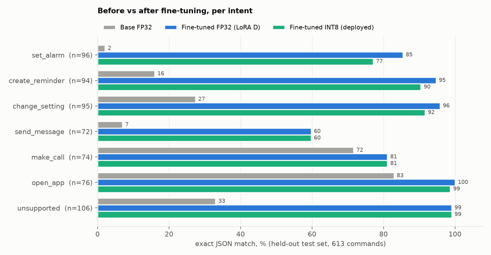
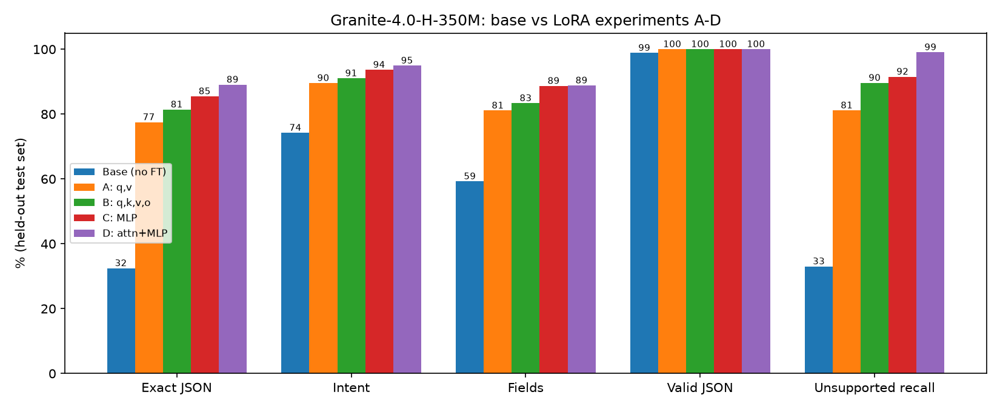
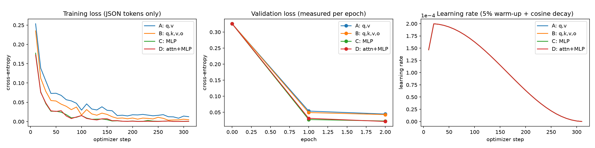
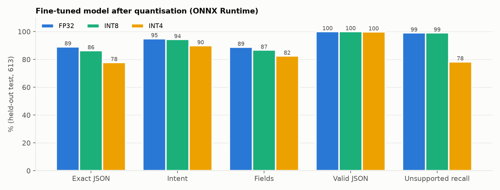
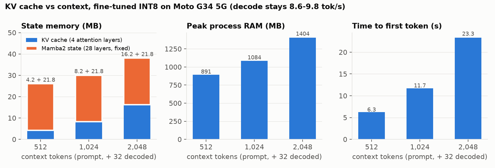
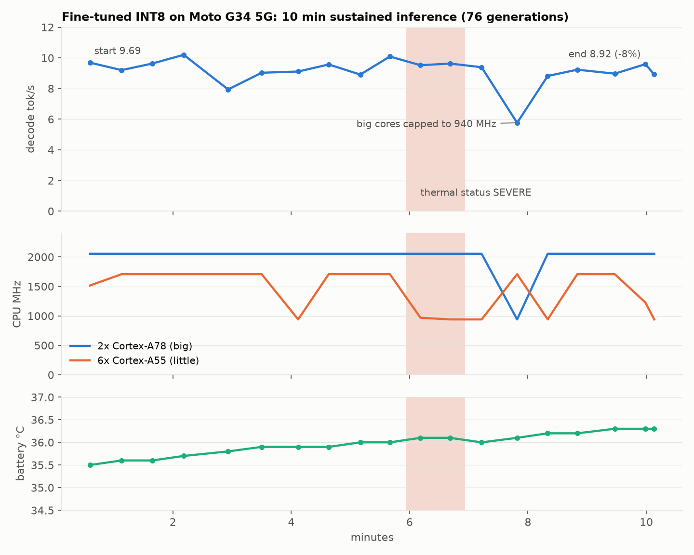
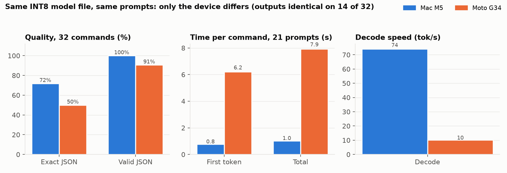

# TronOS on-device voice command parser

A small LLM that runs fully on an Android phone and turns a spoken command into JSON for Android services.

**Pipeline:** microphone → Silero VAD → Moonshine v2 streaming small (speech-to-text, ONNX q8) → **IBM Granite-4.0-H-350M + LoRA** (merged, ONNX INT8) → JSON

```
"Wake me up at 6:30 tomorrow"   -> {"intent": "set_alarm", "time": "06:30", "date": "tomorrow"}
"Text Mom that I'm on my way"   -> {"intent": "send_message", "contact": "Mom", "message": "I'm on my way"}
"Send 2000 to my mom's account" -> {"intent": "unsupported"}
```

**Final report:** [`report/TRONX_Technical_Report.md`](report/TRONX_Technical_Report.md) (18 sections)

## Headline results

Held-out test set (613 commands, never used for training or model selection):

| | Base FP32 | Fine-tuned FP32 (LoRA D, merged) | Fine-tuned INT8 (deployed) |
|---|---:|---:|---:|
| Exact JSON match | 32.5% | **89.1%** | 86.3% |
| Intent accuracy | 74.2% | 94.9% | 94.3% |
| JSON validity | 98.9% | 100% | 100% |
| Unsupported-request recall | 33.0% | 99.1% | 99.1% |

FP32 rows: PyTorch (base) and ONNX Runtime (fine-tuned; identical to PyTorch). INT8: ONNX Runtime CPU.

On the Moto G34 5G (Snapdragon 695, ONNX Runtime Android 1.31.1, fine-tuned INT8):

| Metric | Value |
|---|---|
| Model file | 404 MiB |
| Loading time | 4.1 s |
| Peak RAM | 896 MB |
| Time to first token | 5.9 s |
| Decode speed | 9.8 tok/s |
| 10-min thermal | −8% decode speed, 3% battery |

## Results in charts

### 1. Fine-tuning: before vs after, per intent
The base model (grey) gets only 2% of alarms and 7% of messages exactly right: it invents times, dates and fields. After LoRA fine-tuning (blue), every intent improves, and unsupported requests are refused 99% of the time (base 33%). The deployed INT8 model (green) stays close to FP32. `send_message` (60%) is the weakest intent: the message boundary is hard when the content itself contains a time or a task.



### 2. Which layers to adapt: LoRA experiments A–D
A and B train only the 4 attention layers. C trains the MLP in all 32 layers. D trains both and is the best on every metric, especially refusing unsupported requests (99%).



### 3. Training curves (A–D)
All four runs converge smoothly. Validation loss keeps falling through epoch 2 (D: 0.326 → 0.0215), so the very low training loss is fitting, not harmful over-fitting.



### 4. Quantisation: what precision costs
INT8 keeps almost all of the quality (−2.8 points exact JSON) at 31% of the FP32 size. INT4 saves another 151 MiB but loses 11 points and starts acting on unsupported requests (recall 99% → 78%).



### 5. KV cache on the phone (fine-tuned INT8, Moto G34)
Only 4 of 32 layers use attention, so the KV cache is tiny (4 → 16 MB from 512 to 2,048 tokens). The Mamba state is a fixed 21.8 MB. Decode speed stays about 9–10 tok/s at every context length. What grows is prefill time and temporary memory.



### 6. Thermal: 10 minutes of continuous inference on the phone
The phone throttled briefly (status SEVERE, CPU clocks capped to 940 MHz), but decode speed fell only 8% over 10 minutes. Battery temperature went from 35.4 to 36.3 °C and the run used 3% battery.



### 7. Same INT8 model on Mac vs phone
The same model file and the same input token ids were used on both devices; only the hardware differs. The phone is about 8× slower, and its output differs on 18 of 32 commands. Dynamic INT8 rounds activations at run time, and the phone CPU's integer kernels round slightly differently, which flips close greedy choices. See report Section 15.



## Required attachments

| Attachment | Where |
|---|---|
| Dataset and dataset manifest | [`data/v1.2/`](data/v1.2): `train.jsonl` (2,510), `val.jsonl` (354), `test.jsonl` (613), [`manifest.json`](data/v1.2/manifest.json) (counts, dedup, leakage checks, sha256) |
| Dataset preparation | [`scripts/generate_dataset_v12.py`](scripts/generate_dataset_v12.py), design docs in [`docs/`](docs) |
| Training (overview) | **[`training/README.md`](training/README.md)**: script, configs, hyper-parameters, adapters, logs and curves in one page |
| Training scripts | [`scripts/train_lora.py`](scripts/train_lora.py), Kaggle GPU runner [`kaggle_job/kernel/run.py`](kaggle_job/kernel/run.py), raw training logs [`kaggle_job/logs/`](kaggle_job/logs) |
| LoRA configuration | [`configs/granite__v12__lora_*.json`](configs) (experiments A–D); trained adapters + full config + loss history in [`runs/granite/<exp>/`](runs/granite) |
| Quantization scripts / configuration | [`configs/quantization.json`](configs/quantization.json) (all settings), [`scripts/export_onnx.py`](scripts/export_onnx.py): merge, ONNX export, FP16, INT8 (dynamic, per-channel), INT4 (MatMulNBits block 32) |
| Model evaluation scripts | [`scripts/eval_hf.py`](scripts/eval_hf.py) (PyTorch), [`scripts/eval_onnx.py`](scripts/eval_onnx.py) (ONNX variants), [`scripts/common.py`](scripts/common.py) (prompt, parsing, metrics), [`scripts/error_analysis.py`](scripts/error_analysis.py) |
| Android inference implementation | [`android_voice/`](android_voice): TronX Voice app (VAD + STT + LLM). [`android/`](android): TronX Bench app (Section 9 measurements). Build and run steps below and in [`deliverables/README_PHONE.md`](deliverables/README_PHONE.md) |
| Raw benchmark results | [`results/eval/`](results/eval) (metrics + every prediction), [`results/phone/`](results/phone) (on-device runs), [`results/bench_mac/`](results/bench_mac), [`results/quant/`](results/quant), [`results/stt/`](results/stt) |
| Screenshots / logs | [`deliverables/screenshots/`](deliverables/screenshots), raw phone logs [`results/phone/raw_share_logs_20261110.txt`](results/phone/raw_share_logs_20261110.txt), charts [`results/plots/`](results/plots), model-selection evidence [`evidence/`](evidence) |
| Final report | [`report/TRONX_Technical_Report.md`](report/TRONX_Technical_Report.md) |

## Model weights

All trained weights are published in the release [**v1.0-models**](https://github.com/siranjeevi04/tronx-finetuned-llm/releases/tag/v1.0-models). Git cannot hold files over 100 MB, so the weights are release assets instead of git files.

| File | Model | Precision |
|---|---|---|
| `tronx-granite-350m-onnx-ft_int8.zip` | **Deployed model**: fine-tuned, merged, ONNX | INT8 (404 MiB) |
| `tronx-granite-350m-onnx-ft_int4.zip` | Fine-tuned, merged, ONNX | INT4 (253 MiB) |
| `tronx-granite-350m-onnx-ft_fp16.zip` | Fine-tuned, merged, ONNX | FP16 (651 MiB) |
| `tronx-granite-350m-onnx-ft_fp32.zip` | Fine-tuned, merged, ONNX | FP32 (1.3 GiB) |
| `tronx-granite-350m-loraD-merged-fp32-hf.zip` | Fine-tuned, merged, Hugging Face safetensors | FP32 |
| `tronx-granite-350m-onnx-base_fp16.zip` | Base model, for comparison | FP16 |

The LoRA adapters (A–D) are in git under `runs/granite/<exp>/adapter/`. Each ONNX zip contains `model.onnx` + `model.onnx_data` (keep them together) and the tokenizer.

## Reproduce

To rebuild everything from scratch instead of downloading:

```bash
python3.12 -m venv .venv && source .venv/bin/activate && pip install -r requirements.txt

# 0. base model + reference ONNX graph (Hugging Face)
huggingface-cli download ibm-granite/granite-4.0-h-350m --local-dir models/granite-4.0-h-350m
huggingface-cli download onnx-community/granite-4.0-h-350m-ONNX --local-dir models/onnx_ref

# 1. dataset (deterministic, seed 13) -> data/v1.2/
python scripts/generate_dataset_v12.py

# 2. LoRA training (one experiment; ran on a Kaggle T4, ~1 h each)
python scripts/train_lora.py --config configs/granite__v12__lora_D_attn_mlp.json

# 3. evaluation (validation for selection, test for final numbers)
python scripts/eval_hf.py --model models/granite-4.0-h-350m --adapter runs/granite/D_attn_mlp/adapter \
       --data-dir data/v1.2 --prompt schema --split test --name granite_v12_loraD_attn_mlp_test

# 4. merge -> ONNX -> FP16 / INT8 / INT4
python scripts/export_onnx.py merge --adapter runs/granite/D_attn_mlp/adapter --out models/merged/D
python scripts/export_onnx.py onnx  --hf models/merged/D --out models/onnx/ft_fp32
python scripts/export_onnx.py onnx16 --hf models/merged/D --out models/onnx/ft_fp16
python scripts/export_onnx.py quant --src models/onnx/ft_fp32 --out-root models/onnx --prefix ft
python scripts/eval_onnx.py --model models/onnx/ft_int8 --split test --name onnx_ft_int8_test --threads 4

# 5. Mac counterpart of the on-device benchmark (same prompts and method as the app)
python scripts/bench_mac.py
```

### Android (Kotlin, ONNX Runtime Android 1.31.1, arm64-v8a, Gradle 8.7, AGP 8.5.2, minSdk 29)
1. `python scripts/make_app_assets.py` writes the pre-tokenised prompts and tokenizer files into `android/app/src/main/assets/`.
2. Copy the model into the app assets:
   - Bench app: `models/onnx/ft_int8/*` → `android/app/src/quant/assets/models/3_ft_int8/` (for the `int8` flavor, link or copy the same folder to `android/app/src/int8/assets/models/3_ft_int8/`).
   - Voice app: the same INT8 files → `android_voice/app/src/main/assets/models/llm/`. Moonshine q8 encoder/decoder (`Workmind/moonshine-streaming-small-ONNX`) → `.../models/stt/`. Silero VAD v5 ONNX → `.../models/vad/`.
3. Build:
   - Bench app: `gradle -p android assembleInt8Debug`
   - Voice app: `gradle -p android_voice assembleDebug`
4. Install the APK. The models unpack once to app-private storage. The apps have no network permission; the voice app asks only for the microphone.

## Repo layout
```
data/v1.2/          dataset + manifest
scripts/            dataset, training, evaluation, export/quantisation, benchmark, plotting
configs/            LoRA experiment configs A-D
training/           training overview (start here)
runs/granite/       trained adapters + training logs (A_qv, B_attn, C_mlp, D_attn_mlp)
kaggle_job/         Kaggle GPU runner + logs
results/            all raw results (evaluation, phone, Mac bench, quantisation, STT, plots)
android/            TronX Bench app (Section 9 measurements)
android_voice/      TronX Voice app (speech -> JSON)
report/             final technical report
docs/, evidence/    dataset design, failure analysis, model-selection evidence
deliverables/       phone run guide + screenshots
```

## Licences
- Granite-4.0-H-350M: Apache-2.0.
- Moonshine v2: MIT.
- Silero VAD: MIT.
- ONNX Runtime: MIT.
