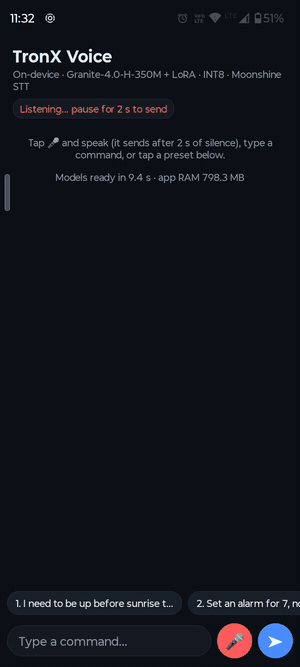

# TronOS on-device voice command parser

A small LLM that runs fully on an Android phone and turns a spoken command into JSON for Android services.

**Pipeline:** microphone → Silero VAD → Moonshine v2 streaming small (speech-to-text, ONNX q8) → **IBM Granite-4.0-H-350M + LoRA** (merged, ONNX INT8) → JSON

```
"Wake me up at 6:30 tomorrow"   -> {"intent": "set_alarm", "time": "06:30", "date": "tomorrow"}
"Text Mom that I'm on my way"   -> {"intent": "send_message", "contact": "Mom", "message": "I'm on my way"}
"Send 2000 to my mom's account" -> {"intent": "unsupported"}
```

**Final report:** [`report/TRONX_Technical_Report.md`](report/TRONX_Technical_Report.md) (18 sections)

## Phone demo (Moto G34 5G, fully on-device, no network)

[](deliverables/demo/tronx-voice-command-assistant-demo.mp4)

*Preview at 4× speed. Full recording (2 min 31 s, muted): [`deliverables/demo/tronx-voice-command-assistant-demo.mp4`](deliverables/demo/tronx-voice-command-assistant-demo.mp4).*

The app in the video is **TronX Voice**. Source: [`android_voice/`](android_voice) (Kotlin; [`MainActivity.kt`](android_voice/app/src/main/java/com/tronx/voice/MainActivity.kt), [`Speech.kt`](android_voice/app/src/main/java/com/tronx/voice/Speech.kt) for VAD + speech-to-text, [`LlmEngine.kt`](android_voice/app/src/main/java/com/tronx/voice/LlmEngine.kt) for the LLM, [`Tokens.kt`](android_voice/app/src/main/java/com/tronx/voice/Tokens.kt) for the on-device tokenizer). Build steps are in the [Android section](#android-app-build-and-install) below.

Pipeline: tap the mic and speak → Silero VAD detects 2 s of silence → Moonshine speech-to-text → fine-tuned Granite INT8 → JSON. Every reply card shows the JSON plus RAM and timings. Measured values from the video:

| What was said (speech-to-text output) | JSON from the fine-tuned INT8 model | Correct | Speech → JSON | Speech-to-text | LLM | First token | App RAM |
|---|---|:-:|---:|---:|---:|---:|---:|
| Hey Kenny, please launch the camera. I just want to take a picture. | `{"intent": "open_app", "app_name": "Camera"}` | ✅ | 10.0 s | 1.0 s | 9.0 s | 7.8 s | 1,059 MB |
| The volume is 2 I can you bring it down to 30% | `{"intent": "change_setting", "setting": "volume", "action": "set", "value": 30}` | ✅ | 10.5 s | 0.9 s | 9.6 s | 6.8 s | 1,152 MB |
| Or can you like set an alarm for 7? No wait it's 7:45 in the evening | `{"intent": "set_alarm", "time": "19:45"}` | ✅ | 9.2 s | 1.3 s | 7.9 s | 6.6 s | 1,238 MB |
| Um okay can you video call my grandma | `{"intent": "make_call", "contact": "Grandma"}` | ✅ | 7.2 s | 0.6 s | 6.6 s | 5.4 s | 1,240 MB |
| Okay can you please text my mom that I'm going to work | `{"intent": "send_message", "contact": "Mom", "message": "I'm going to work"}` | ✅ | 8.9 s | 1.1 s | 7.8 s | 5.8 s | 1,244 MB |
| Okay, can you arm the security alarm before I leave the house? | `{"intent": "change_setting", "setting": "security", "action": "arm"}` | ❌ (should be unsupported) | 8.5 s | 0.9 s | 7.6 s | 5.9 s | 1,245 MB |
| Can you please arm the home security alarm before I leave? | `{"intent": "unsupported"}` | ✅ | 7.2 s | 0.7 s | 6.5 s | 6.0 s | 1,257 MB |

**Averages over the 7 commands:**
- Speech → JSON: **8.8 s**
- Speech-to-text: **0.9 s**
- LLM: **7.9 s**
- Whole app (speech-to-text + VAD + LLM loaded): **1.06–1.26 GB RAM**

The model copes with filler words ("um", "like"), a self-correction ("7? No wait 7:45") and speech-to-text noise ("The volume is 2 I…"). It still gets 6 of 7 right.

## Headline results

Held-out test set (613 commands, never used for training or model selection):

| | Base FP32 | Fine-tuned FP32 (LoRA D, merged) | Fine-tuned INT8 (deployed) |
|---|---:|---:|---:|
| Exact JSON match | 32.5% | **89.1%** | 86.3% |
| Intent accuracy | 74.2% | 94.9% | 94.3% |
| JSON validity | 98.9% | 100% | 100% |
| Unsupported-request recall | 33.0% | 99.1% | 99.1% |

FP32 rows: PyTorch (base) and ONNX Runtime (fine-tuned; identical to PyTorch). INT8: ONNX Runtime CPU.

On the Moto G34 5G (Snapdragon 695, ONNX Runtime Android 1.31.1, fine-tuned INT8):

| Metric | Value |
|---|---|
| Model file | 404 MiB |
| Loading time | 4.1 s |
| Peak RAM | 896 MB |
| Time to first token | 5.9 s |
| Decode speed | 9.8 tok/s |
| 10-min thermal | −8% decode speed, 3% battery |

## How the model was chosen

Full write-up with every source: report [Section 3](report/TRONX_Technical_Report.md#3-base-model-selection). Proof screenshots: [`evidence/`](evidence).

1. **Size limit from the phone: about 350 M parameters.**
   - The Moto G34's Snapdragon 695 has only 17 GB/s memory bandwidth ([Qualcomm brief](evidence/device_feasibility/01_qualcomm_snapdragon-695_product_brief.pdf)), and every generated token reads all the weights.
   - Scaling a measured 1 B model ([proof](evidence/device_feasibility/02_measured_llama-3.2-1b_q4_0_snapdragon-8gen1.png), [estimate script](evidence/device_feasibility/estimate_moto_g34.py)) gives about 11–12 s per command for 1 B-class models vs about 2.4 s for 350 M (estimates).
   - Measured afterwards: our 350 M INT8 model decodes at 9.8 tok/s on the phone.
2. **Benchmarks used:** IFEval (strict format following, as needed for JSON-only output) and BFCL v3/v4 (function calling, the same skill as intent + fields).
3. **All 13 open models at or below 400 M were compared** ([matrix with sources](evidence/llm_selection/ELIMINATION_MATRIX.md)). The two best:

| Model | IFEval | BFCL v3 | Licence | Proof |
|---|---:|---:|---|---|
| LiquidAI LFM2.5-350M | 76.96 | 44.11 | LFM Open License (commercial only if revenue ≤ $10 M) | [benchmarks](evidence/llm_selection/07_liquid_benchmark_chart_official.png), [licence](evidence/llm_selection/06_liquid_lfm-license.png) |
| **IBM Granite-4.0-H-350M** | 61.27 | 43.07 | **Apache-2.0** | [benchmarks](evidence/llm_selection/01_liquid_lfm2.5-230m_blog_benchmark_tables.png), [IBM card](evidence/llm_selection/03_ibm_granite-4.0-1b_card_nano_benchmarks.png) |

   Everything else was weaker on both benchmarks, had no published scores, or had a non-commercial licence.
4. **Head-to-head on our own task** (same prompt, zero-shot, 395 commands): Granite won every metric except unsupported-request detection, including the headline exact JSON match.

| | Granite-4.0-H-350M | LFM2.5-350M |
|---|---:|---:|
| Exact JSON | **41.8%** | 29.6% |
| Fields | **74.4%** | 49.7% |
| Intent | **82.3%** | 78.7% |
| Valid JSON | **98.5%** | 96.5% |
| Unsupported recall | 42.9% | **58.9%** |

   LFM was better only at refusing unsupported requests zero-shot. That metric was noisy in this early dataset (10 sentence patterns), and fine-tuning fixed it: Granite reaches 99.1% after LoRA. With the large lead on exact JSON and fields, plus the Apache-2.0 licence, Granite was selected.

## Consolidated performance report

**Table 1: model variants.** Accuracy is on the held-out test set (613 commands). Device measurements are from the **phone** (Moto G34 5G) for the deployed INT8 model and from the **Mac** (Apple M5) for all variants. All runs use ONNX Runtime 1.31.1 CPU with 4 threads.

| Metric | Base FP16 | Fine-tuned FP16 | **Fine-tuned INT8** | Fine-tuned INT4 |
|---|---:|---:|---:|---:|
| Model file size | 651.5 MiB | 651.5 MiB | **404.4 MiB** | 252.7 MiB |
| Model loading memory | +1,280 MB (Mac) | +1,281 MB (Mac) | **+327 MB phone** / +390 MB Mac | +287 MB (Mac) |
| Peak inference RAM | 1,558 MB (Mac) | 1,558 MB (Mac) | **896 MB phone** / 786 MB Mac | 684 MB (Mac) |
| KV cache – 512 tokens | 2.12 MB | 2.12 MB | **4.24 MB** | 4.24 MB |
| KV cache – 1K tokens | 4.12 MB | 4.12 MB | **8.24 MB** | 8.24 MB |
| KV cache – 2K tokens | 8.12 MB | 8.12 MB | **16.24 MB** | 16.24 MB |
| Time to first token | 1.45 s (Mac) | 1.58 s (Mac) | **5.92 s phone** / 0.57 s Mac | 0.85 s (Mac) |
| Decode tokens/sec | 58.5 (Mac) | 57.7 (Mac) | **9.8 phone** / 101.0 Mac | 124.0 (Mac) |
| Intent accuracy | 74.4% | 94.9% | **94.3%** | 89.9% |
| Field accuracy | 59.8% | 88.8% | **86.7%** | 82.4% |
| Exact JSON match | 32.8% | 89.1% | **86.3%** | 77.8% |
| JSON validity | 99.0% | 100% | **100%** | 99.8% |
| Thermal throttling | n/a | n/a | **Mild on phone:** −8% decode after 10 min continuous; brief SEVERE status; 35.4 → 36.3 °C; 3% battery | n/a |

Notes:
- **KV cache** values are identical on Mac and phone (same tensors). FP16 keeps FP16 states; INT8/INT4 keep FP32 states.
- **Thermal behaviour** was measured for the deployed model (INT8).
- **Accuracy runtimes:**
  - Base FP16: PyTorch FP16 (Base FP32 for reference: 32.5% exact).
  - Fine-tuned variants: ONNX Runtime on the Mac.
  - INT8 accuracy on the phone is reported separately (report Section 9.4).

**Table 2: LoRA target-module experiments** (same data, seed and hyper-parameters; r 16, alpha 32, dropout 0.05; FP32):

| Exp | Target modules | Trainable params | Adapter | Training time | Val exact | Test exact | JSON validity | Unsupported recall | Inference (T4, per command) |
|---|---|---:|---:|---:|---:|---:|---:|---:|---:|
| A | q, v | 163,840 | 0.6 MiB | 51 min | 81.6% | 77.5% | 100% | 81.1% | 334 ms |
| B | q, k, v, o | 327,680 | 1.3 MiB | 52 min | 85.0% | 81.4% | 100% | 89.6% | 344 ms |
| C | MLP | 3,932,160 | 15.0 MiB | 61 min | 91.2% | 85.5% | 100% | 91.5% | 338 ms |
| **D** | **attention + MLP** | **4,259,840** | **16.3 MiB** | 61 min | **91.2%** | **89.1%** | **100%** | **99.1%** | 348 ms |

**Best configuration for TronOS: LoRA D, merged, INT8.**
- It keeps 97% of full-precision exact match (86.3% vs 89.1%) and the same 99.1% refusal of unsupported requests.
- It is 1.6× smaller than FP16 and uses about half the RAM of FP16 on CPU.
- It has the fastest time to first token of all variants.
- INT4 is smaller and decodes faster, but loses 11 points and starts acting on unsupported requests. Full justification: report Section 17.

## Results in charts

### 1. Fine-tuning: before vs after, per intent
The base model (grey) gets only 2% of alarms and 7% of messages exactly right: it invents times, dates and fields. After LoRA fine-tuning (blue), every intent improves, and unsupported requests are refused 99% of the time (base 33%). The deployed INT8 model (green) stays close to FP32. `send_message` (60%) is the weakest intent: the message boundary is hard when the content itself contains a time or a task.


### 2. Which layers to adapt: LoRA experiments A–D
A and B train only the 4 attention layers. C trains the MLP in all 32 layers. D trains both and is the best on every metric, especially refusing unsupported requests (99%).


### 3. Training curves (A–D)
All four runs converge smoothly. Validation loss keeps falling through epoch 2 (D: 0.326 → 0.0215), so the very low training loss is fitting, not harmful over-fitting.


### 4. Quantisation: what precision costs
FP16 is identical to FP32 (89.1%). INT8 keeps almost all of the quality (−2.8 points exact JSON) at 31% of the FP32 size. INT4 saves another 152 MiB but loses 11 points and starts acting on unsupported requests (recall 99% → 78%).


### 5. KV cache on the phone (fine-tuned INT8, Moto G34)
Only 4 of 32 layers use attention, so the KV cache is tiny (4 → 16 MB from 512 to 2,048 tokens). The Mamba state is a fixed 21.8 MB. Decode speed stays about 9–10 tok/s at every context length. What grows is prefill time and temporary memory.


### 6. Thermal: 10 minutes of continuous inference on the phone
The phone throttled briefly (status SEVERE, CPU clocks capped to 940 MHz), but decode speed fell only 8% over 10 minutes. Battery temperature went from 35.4 to 36.3 °C and the run used 3% battery.


### 7. Same INT8 model on Mac vs phone
The same model file and the same input token ids were used on both devices; only the hardware differs. The phone is about 8× slower, and its output differs on 18 of 32 commands. Dynamic INT8 rounds activations at run time, and the phone CPU's integer kernels round slightly differently, which flips close greedy choices. See report Section 15.


## Examples: base vs fine-tuned INT8 on Mac and phone

10 example commands that were run on all three: base model, fine-tuned INT8 on the Mac and fine-tuned INT8 on the phone (Moto G34). All three received identical input token ids. ✅ = exact JSON match.

| # | Command | Base FP32 (Mac) | Fine-tuned INT8 (Mac) | Fine-tuned INT8 (phone) |
|---|---|---|---|---|
| 1 | Set an alarm in half an hour. | ❌ `{"intent": "set_alarm", "time": "06:30", "date": "tomorrow"}` | ✅ `{"intent": "set_alarm", "in": "00:30"}` | ✅ `{"intent": "set_alarm", "in": "00:30"}` |
| 2 | video call grandma | ❌ `{"intent": "create_reminder", "task": "video call grandma", "time": "18:00"}` | ✅ `{"intent": "make_call", "contact": "Grandma"}` | ✅ `{"intent": "make_call", "contact": "Grandma"}` |
| 3 | send 2000 to my mom's account | ❌ `{"intent": "send_message", "contact": "Mom", "message": "2000"}` | ✅ `{"intent": "unsupported"}` | ✅ `{"intent": "unsupported"}` |
| 4 | set an alarm for 7 no wait its 7 45 in the evening | ❌ `{"intent": "set_alarm", "time": "19:45", "date": "today", "in": "relative time as "in 45 minutes""}` | ✅ `{"intent": "set_alarm", "time": "19:45"}` | ✅ `{"intent": "set_alarm", "time": "19:45"}` |
| 5 | bring the volume to about 30 percent | ✅ `{"intent": "change_setting", "setting": "volume", "action": "set", "value": 30}` | ✅ `{"intent": "change_setting", "setting": "volume", "action": "set", "value": 30}` | ✅ `{"intent": "change_setting", "setting": "volume", "action": "set", "value": 30}` |
| 6 | turn on wifi | ✅ `{"intent": "change_setting", "setting": "wifi", "action": "on"}` | ✅ `{"intent": "change_setting", "setting": "wifi", "action": "on"}` | ✅ `{"intent": "change_setting", "setting": "wifi", "action": "on"}` |
| 7 | arm the home security alarm before i leave | ❌ `{"intent": "set_alarm", "time": "06:30", "date": "tomorrow", "in": "relative time", "label": "home"}` | ❌ `{"intent": "set_alarm", "label": "home security", "action": "on"}` | ✅ `{"intent": "unsupported"}` |
| 8 | enable airplane mode | ❌ `{"intent": "set_alarm", "time": "08:00", "date": "today", "in": "relative time"}` | ✅ `{"intent": "change_setting", "setting": "airplane_mode", "action": "on"}` | ❌ `{"intent": "change_setting", "setting": "airplane_mode"}` |
| 9 | send fatima a message on telegram saying the class is cancelled | ❌ `{"intent": "send_message", "contact": "Fatima", "message": "the class is cancelled"}` | ✅ `{"intent": "send_message", "contact": "Fatima", "message": "the class is cancelled", "app": "Telegram"}` | ❌ `assistant` |
| 10 | i an hr and a half remind me to check on the briyani | ❌ `{"intent": "create_reminder", "task": "check on the briyani", "time": "13:30", "date": "today"}` | ✅ `{"intent": "create_reminder", "task": "check on the briyani", "in": "01:30"}` | ❌ `{"intent": "create_reminder", "task": "check on the briyani", "time": "01:30"}` |
| | **Correct** | **2 / 10** | **9 / 10** | **7 / 10** |

**All commands tested on both devices** (32 commands outside the training data: demo prompts, hard informal commands with typos, and free-typed commands):

| Command set | n | Base FP32 (Mac) | Fine-tuned INT8 (Mac) | Fine-tuned INT8 (phone) |
|---|---:|---:|---:|---:|
| Demo prompts (where the base model fails) | 10 | 0 | 9 | 7 |
| Hard commands (typos, informal, self-corrections) | 11 | 4 | 6 | 5 |
| Free-typed commands in the phone app | 11 | 6 | 9 | 4 |
| **Total** | **32** | **10 (31%)** | **24 (75%)** | **16 (50%)** |

The fine-tuned model is better than the base model on both devices. On the full 613-command test set, the gap is much larger (32.5% → 86.3% for INT8).

**Why the phone scores lower than the Mac with the same model file:**
1. **Same input, same file:** the token ids were verified identical, and the INT8 file has the same checksum on both devices. The Mac is deterministic: identical outputs at 1, 4 and 8 threads. So the difference is neither randomness nor a bug.
2. **INT8 here is *dynamic* quantization:** weights are stored as 8-bit integers, but each layer's activations are rounded to 8 bits **at run time**, with a scale computed from the current values.
3. **Different CPUs run different kernels:**
   - The phone (Snapdragon 695: Cortex-A78/A55, Armv8.2 dot-product instructions) and the Mac (Apple M5, newer int8 matrix instructions) use different ONNX Runtime kernels.
   - Different kernels add the floating-point parts (normalisation, the Mamba state update, attention, the run-time scales) in a different order, so the results differ in the last few bits.
4. **Tiny differences can flip a token:** a value near a rounding boundary rounds to a different 8-bit number. After 32 layers and about 500 prompt tokens, this can flip a near-tie in greedy decoding. From that token on, the answers diverge.
5. **It goes both ways:** example 7 is right on the phone and wrong on the Mac. On average the phone loses more, because its kernels differ further from the reference numerics.

**Fix (report Section 18):** weight-only or calibrated static INT8, which has no run-time activation rounding, plus JSON-constrained decoding. Both keep the file size the same.

## Required attachments

| Attachment | Where |
|---|---|
| Dataset and dataset manifest | [`data/v1.2/`](data/v1.2): `train.jsonl` (2,510), `val.jsonl` (354), `test.jsonl` (613), [`manifest.json`](data/v1.2/manifest.json) (counts, dedup, leakage checks, sha256); hand-written test commands source [`data/raw/handwritten.jsonl`](data/raw/handwritten.jsonl) |
| Dataset preparation | [`scripts/generate_dataset_v12.py`](scripts/generate_dataset_v12.py), design docs in [`docs/`](docs) |
| Training (overview) | **[`training/README.md`](training/README.md)**: script, configs, hyper-parameters, adapters, logs and curves in one page |
| Training scripts | [`scripts/train_lora.py`](scripts/train_lora.py), Kaggle GPU runner [`kaggle_job/kernel/run.py`](kaggle_job/kernel/run.py), raw training logs [`kaggle_job/logs/`](kaggle_job/logs) |
| LoRA configuration | [`configs/granite__v12__lora_*.json`](configs) (experiments A–D); trained adapters + full config + loss history in [`runs/granite/<exp>/`](runs/granite) |
| Quantization scripts / configuration | [`configs/quantization.json`](configs/quantization.json) (all settings), [`scripts/export_onnx.py`](scripts/export_onnx.py): merge, ONNX export, FP16, INT8 (dynamic, per-channel), INT4 (MatMulNBits block 32) |
| Model evaluation scripts | [`scripts/eval_hf.py`](scripts/eval_hf.py) (PyTorch), [`scripts/eval_onnx.py`](scripts/eval_onnx.py) (ONNX variants), [`scripts/common.py`](scripts/common.py) (prompt, parsing, metrics), [`scripts/error_analysis.py`](scripts/error_analysis.py) |
| Android inference implementation | [`android_voice/`](android_voice): TronX Voice app (VAD + STT + LLM). [`android/`](android): TronX Bench app (Section 9 measurements). Build and run steps below and in [`deliverables/README_PHONE.md`](deliverables/README_PHONE.md) |
| Raw benchmark results | [`results/eval/`](results/eval) (metrics + every prediction), [`results/phone/`](results/phone) (on-device runs), [`results/bench_mac/`](results/bench_mac), [`results/quant/`](results/quant), [`results/stt/`](results/stt) |
| Screenshots / logs | [`deliverables/screenshots/`](deliverables/screenshots), raw phone logs [`results/phone/raw_share_logs_20261110.txt`](results/phone/raw_share_logs_20261110.txt), charts [`results/plots/`](results/plots), model-selection evidence [`evidence/`](evidence) |
| Final report | [`report/TRONX_Technical_Report.md`](report/TRONX_Technical_Report.md) |

## Reproduce

Model weights are not stored in git (files over 100 MB). The LoRA adapters (A–D) are in `runs/granite/<exp>/adapter/`; every model variant is regenerated from them with the steps below.

```bash
python3.12 -m venv .venv && source .venv/bin/activate && pip install -r requirements.txt

# 0. base model + reference ONNX graph (Hugging Face)
huggingface-cli download ibm-granite/granite-4.0-h-350m --local-dir models/granite-4.0-h-350m
huggingface-cli download onnx-community/granite-4.0-h-350m-ONNX --local-dir models/onnx_ref
# speech-to-text (Moonshine v2 streaming small, ONNX) + voice activity detection (Silero VAD v5), used by the voice app
huggingface-cli download Workmind/moonshine-streaming-small-ONNX --local-dir models/stt/moonshine-streaming-small-ONNX
huggingface-cli download istupakov/silero-vad-onnx silero_vad.onnx --local-dir models/vad

# 1. dataset (deterministic, seed 13) -> data/v1.2/   (reads data/raw/handwritten.jsonl; output is byte-identical to the committed files)
python scripts/generate_dataset_v12.py
#    (the model bake-off in report Section 3.5 used the earlier v1.1 dataset: scripts/generate_dataset.py)

# 2. LoRA training (one experiment; ran on a Kaggle T4, ~1 h each)
python scripts/train_lora.py --config configs/granite__v12__lora_D_attn_mlp.json

# 3. evaluation (validation for selection, test for final numbers)
python scripts/eval_hf.py --model models/granite-4.0-h-350m --adapter runs/granite/D_attn_mlp/adapter \
       --data-dir data/v1.2 --prompt schema --split test --name granite_v12_loraD_attn_mlp_test

# 4. merge -> ONNX -> FP16 / INT8 / INT4
python scripts/export_onnx.py merge --adapter runs/granite/D_attn_mlp/adapter --out models/merged/D
python scripts/export_onnx.py onnx  --hf models/merged/D --out models/onnx/ft_fp32
python scripts/export_onnx.py onnx16 --hf models/merged/D --out models/onnx/ft_fp16
python scripts/export_onnx.py quant --src models/onnx/ft_fp32 --out-root models/onnx --prefix ft
python scripts/eval_onnx.py --model models/onnx/ft_int8 --split test --name onnx_ft_int8_test --threads 4
# base model in FP16: ONNX file (for the benchmark) + accuracy
python scripts/export_onnx.py verify16          # -> models/onnx/base_fp16
python scripts/eval_hf.py --model models/granite-4.0-h-350m --data-dir data/v1.2 --prompt schema --split test \
       --dtype fp16 --name granite_v12_base_fp16_test

# 5. Mac counterpart of the on-device benchmark (same prompts and method as the app)
python scripts/bench_mac.py
```

### Android app: build and install
Kotlin, ONNX Runtime Android 1.31.1, arm64-v8a, Gradle 8.7, AGP 8.5.2, minSdk 29.
1. `python scripts/make_app_assets.py` regenerates every tokenizer and prompt asset of both apps (`prompts.json`, `vocab.json`, `merges.txt`, and `stt_vocab.json` for the voice app). The output is identical to the committed files.
2. Copy the model into the app assets:
   - Bench app: `models/onnx/ft_int8/*` → `android/app/src/quant/assets/models/3_ft_int8/` (for the `int8` flavor, link or copy the same folder to `android/app/src/int8/assets/models/3_ft_int8/`).
   - Voice app: the same INT8 files → `android_voice/app/src/main/assets/models/llm/`. Moonshine q8 files `onnx/encoder_model_quantized.onnx` → `.../models/stt/encoder.onnx` and `onnx/decoder_model_merged_quantized.onnx` → `.../models/stt/decoder.onnx`. `models/vad/silero_vad.onnx` → `.../models/vad/`.
3. Build:
   - Bench app: `gradle -p android assembleInt8Debug`
   - Voice app: `gradle -p android_voice assembleDebug`
4. Install the APK. The models unpack once to app-private storage. The apps have no network permission; the voice app asks only for the microphone.

## Repo layout
```
data/v1.2/          dataset + manifest
scripts/            dataset, training, evaluation, export/quantisation, benchmark, plotting
configs/            LoRA experiment configs A-D
training/           training overview (start here)
runs/granite/       trained adapters + training logs (A_qv, B_attn, C_mlp, D_attn_mlp)
kaggle_job/         Kaggle GPU runner + logs
results/            all raw results (evaluation, phone, Mac bench, quantisation, STT, plots)
android/            TronX Bench app (Section 9 measurements)
android_voice/      TronX Voice app (speech -> JSON)
report/             final technical report
docs/, evidence/    dataset design, failure analysis, model-selection evidence
deliverables/       phone run guide + screenshots
```

## Licences
- Granite-4.0-H-350M: Apache-2.0.
- Moonshine v2: MIT.
- Silero VAD: MIT.
- ONNX Runtime: MIT.
