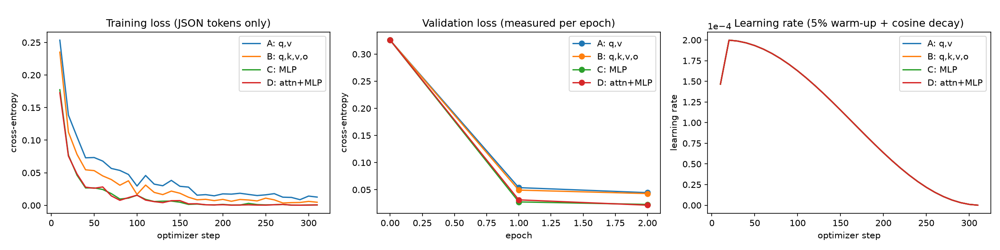
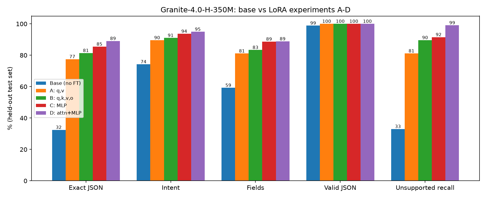
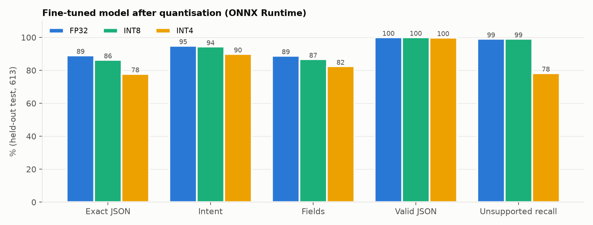
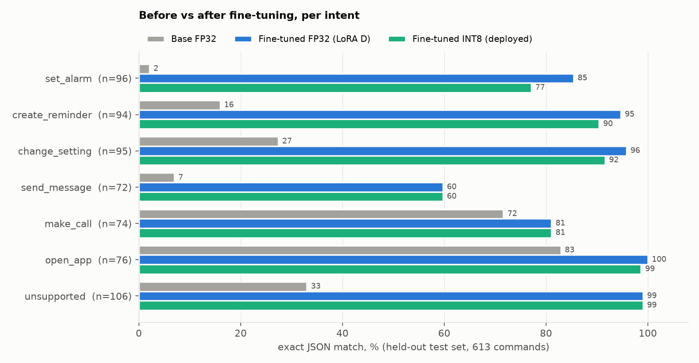
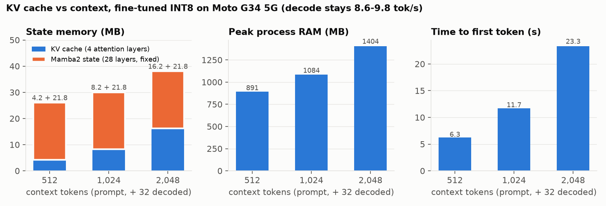
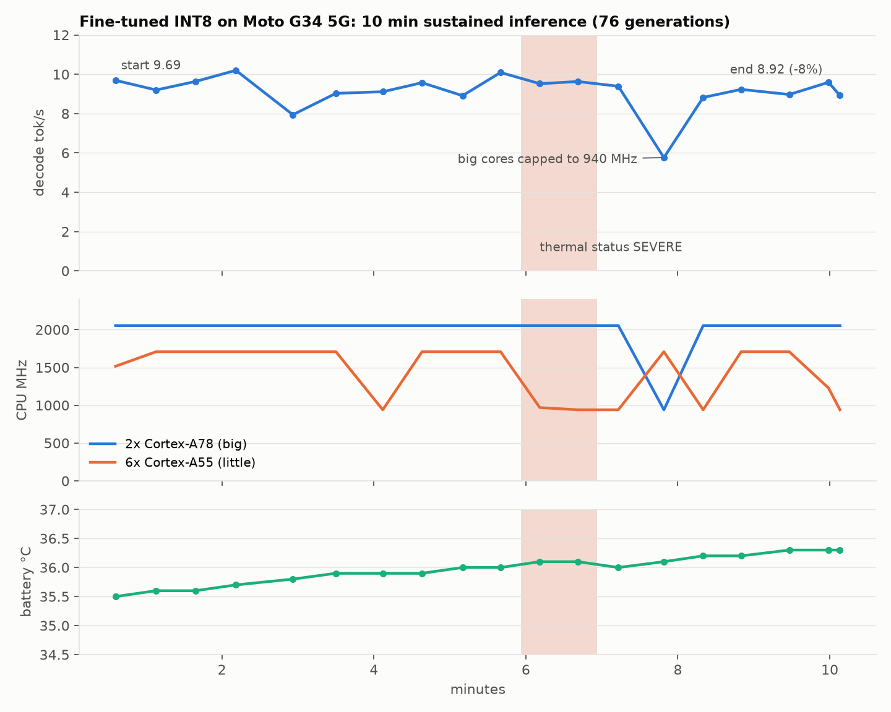
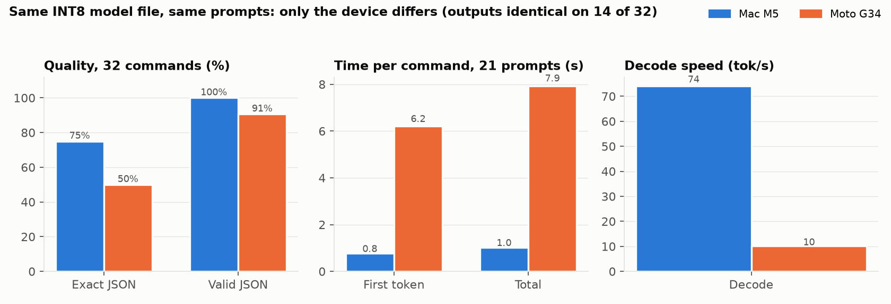

# TronOS Voice Command Parser: On-Device LLM Technical Report

**Model:** IBM Granite-4.0-H-350M + LoRA (attention + MLP), merged, ONNX INT8
**Speech-to-text:** Moonshine v2 streaming small (ONNX q8), used as-is
**Target device:** Motorola Moto G34 5G (Snapdragon 695, 8 GB RAM), ONNX Runtime Android 1.31.1
**Date:** 10 November 2026

---

## 1. Executive summary

TronOS needs a small model that runs fully on the phone and turns a spoken command into JSON that Android services can execute. We built the full pipeline: microphone, voice activity detection, Moonshine speech-to-text, then a fine-tuned Granite-4.0-H-350M that outputs the JSON. It runs on a mid-range Moto G34 5G with no network permission.

Main results (held-out test set, 613 commands, never used for training or model selection; precision stated per column):

| | Base FP32 | Fine-tuned FP32 (LoRA D, merged) | Fine-tuned INT8 (deployed) |
|---|---:|---:|---:|
| Exact JSON match | 32.5% | **89.1%** | 86.3% |
| Intent accuracy | 74.2% | 94.9% | 94.3% |
| Field accuracy | 59.3% | 88.8% | 86.7% |
| JSON validity | 98.9% | 100% | 100% |
| Unsupported-request recall | 33.0% | 99.1% | 99.1% |

FP32 = full precision (base: PyTorch; fine-tuned: ONNX Runtime, identical to PyTorch). INT8 = ONNX Runtime CPU (Section 8).

- LoRA fine-tuning raised exact JSON match from 32.5% to 89.1% (+56.6 points) by training only 1.25% of the parameters (4.26 M).
- The adapter was merged into the base weights and quantized. INT8 keeps 94% of outputs byte-identical to full precision and loses 2.8 points of exact match. The file shrinks from 1.27 GiB (FP32) to 404 MiB.
- On the Moto G34 the INT8 model loads in 4.1 s and uses about 0.9 GB of process RAM. Time to first token is 5.9 s and decode speed is 9.8 tokens/s. A 10-minute sustained test caused mild throttling (−8% decode speed).
- **Recommended configuration for TronOS: fine-tuned INT8** (Section 17). INT4 is 38% smaller than INT8 but loses 8.5 points vs INT8 (−11.3 vs FP32) and starts acting on out-of-scope requests.
- Main limitations (Section 16): phone INT8 output differs from Mac INT8 for the same file, the long system prompt makes time to first token slow, and some phrasing patterns are still unlearned.

**Measured vs estimated:** every number in this report is measured unless it is explicitly marked **Estimate**. Estimates appear only in Section 3 (device feasibility) and Section 18 (future optimizations).

---

## 2. Use case and requirements

The user speaks a command. The phone must return one JSON object with an `intent` and only the fields that were actually said:

| Intent | Fields |
|---|---|
| `set_alarm` | `time` (HH:MM, 24 h), `date`, `label`, `in` (relative, HH:MM from now) |
| `create_reminder` | `task`, `time`, `date`, `in` |
| `open_app` | `app_name` |
| `make_call` | `contact` |
| `send_message` | `contact`, `message`, `app` |
| `change_setting` | `setting`, `action` (on/off/set/increase/decrease), `value` |
| `unsupported` | none |

Examples:
```
"Wake me up at 6:30 tomorrow"          -> {"intent": "set_alarm", "time": "06:30", "date": "tomorrow"}
"Text Mom that I'm on my way"          -> {"intent": "send_message", "contact": "Mom", "message": "I'm on my way"}
"Send 2000 rupees to my mom's account" -> {"intent": "unsupported"}
```

Requirements we designed for:
1. **Valid, exact JSON.** Android code consumes the output directly, so the headline metric is exact match: correct intent, every field correct, no extra fields.
2. **Never invent fields.** A guessed time or contact creates a wrong alarm or calls the wrong person.
3. **Refuse what is not supported** (payments, bookings, questions). Acting on an unsupported request is worse than doing nothing.
4. **Run fully on device** on a mid-range phone: limited RAM, memory bandwidth (17 GB/s on the Snapdragon 695), CPU and battery.

Project decisions beyond the problem statement:
- **Language: English only**, matching the English-only Moonshine speech model.
- **Time without am/pm is kept literal** ("alarm for 7" gives `07:00`); Android can confirm.
- **Multi-action commands: the first action decides.** If the first action is unsupported, the whole command is unsupported, so the assistant never half-executes something like a payment.
- **Added an optional `in` field** for relative times ("remind me in 20 minutes" gives `"in": "00:20"`). Without it the base model invented clock times.

---

## 3. Base model selection

The model was chosen in four steps:
1. Size limit set by the phone.
2. Shortlist by published benchmarks.
3. Licence and runtime filter.
4. Head-to-head test on our own task.

Proof files are in [`evidence/`](../evidence). Every claim below links to a screenshot or a source page.

### 3.1 Why the model must be about 350 M parameters (phone limit)

The target phone is a Moto G34 5G: Snapdragon 695, 2× Cortex-A78 + 6× Cortex-A55, 8 GB LPDDR4X.

**Speed is set by memory bandwidth.** Generating each token reads all the weights once, so the maximum speed is tokens/s ≤ memory bandwidth ÷ model size in bytes. The Snapdragon 695 has only **17.06 GB/s** ([Qualcomm product brief](../evidence/device_feasibility/01_qualcomm_snapdragon-695_product_brief.pdf)). That is 3× less than a flagship Snapdragon 8 Gen 1 (51.2 GB/s).

**Measured reference point:** Llama-3.2-1B (4-bit) on a Snapdragon 8 Gen 1 reached 12 tok/s decode ([screenshot](../evidence/device_feasibility/02_measured_llama-3.2-1b_q4_0_snapdragon-8gen1.png)). Scaled to the G34's bandwidth ([`estimate_moto_g34.py`](../evidence/device_feasibility/estimate_moto_g34.py), [output](../evidence/device_feasibility/estimate_output.txt)):

| Model (4-bit) | **Estimate:** decode tok/s on G34 | **Estimate:** time per command |
|---|---:|---:|
| LFM3-1.7B | 2.8 | ~12 s |
| Granite-4.0-1B | 3.0 | ~11 s |
| LFM2.5-350M | 13.4 | ~2.5 s |
| Granite-4.0-H-350M | 13.8 | ~2.4 s |

A 1 B-class model would take 4–5× longer per command than a 350 M model, even at 4 bits, so the size limit was set to **≤ 400 M parameters**.

**Measured confirmation (after deployment):** the chosen 350 M model at INT8 decodes at **9.8 tok/s** on this phone (Section 13). That is in line with the estimate. A model 3× larger would fall to about 3 tok/s.

### 3.2 Benchmarks used to rank candidates

No public benchmark measures our exact task (one spoken command → intent + fields as JSON). We used the two closest proxies:

| Benchmark | What it measures | Why it matters for TronOS |
|---|---|---|
| **IFEval** | Following strict format instructions | The model must output *only* a JSON object, in our schema |
| **BFCL v3 / v4** (Berkeley Function-Calling Leaderboard) | Picking the right function and filling its arguments | The same skill as intent (function) + fields (arguments) |

Sources:
- **Same-harness comparison** run by Liquid AI: [chart](../evidence/llm_selection/07_liquid_benchmark_chart_official.png) and [tables](../evidence/llm_selection/01_liquid_lfm2.5-230m_blog_benchmark_tables.png), from https://www.liquid.ai/blog/lfm2-5-230m.
- **Model cards:** IBM ([screenshot](../evidence/llm_selection/03_ibm_granite-4.0-1b_card_nano_benchmarks.png)), Qwen ([screenshot](../evidence/llm_selection/04_qwen3.5-0.8b_card_benchmarks.png)), Google, Hugging Face, Apple, Meta.
- **Third-party leaderboard:** BFCL v4 on llm-stats.com ([screenshot](../evidence/llm_selection/02_llm-stats_bfcl-v4_leaderboard.png)).

The Liquid AI table is vendor-run, so it may favour Liquid's own models. IBM's own card gives nearly identical Granite numbers (IFEval 61.63, BFCL v3 43.32), which cross-checks it.

### 3.3 Every candidate at or below 400 M parameters

Full matrix with sources: [`evidence/llm_selection/ELIMINATION_MATRIX.md`](../evidence/llm_selection/ELIMINATION_MATRIX.md).

| Model | Params | IFEval | BFCL v3 | Licence | Verdict | Reason | Proof |
|---|---:|---:|---:|---|---|---|---|
| LiquidAI LFM2.5-350M | 350 M | **76.96** | **44.11** | LFM Open License (commercial use only if revenue ≤ $10 M) | **Shortlisted** | Best scores in the size range | [07](../evidence/llm_selection/07_liquid_benchmark_chart_official.png), [01](../evidence/llm_selection/01_liquid_lfm2.5-230m_blog_benchmark_tables.png), [05](../evidence/llm_selection/05_lfm2.5-350m_card.png), [licence](../evidence/llm_selection/06_liquid_lfm-license.png) |
| **IBM Granite-4.0-H-350M** | 340 M | 61.27 (IBM: 61.63) | 43.07 (IBM: 43.32) | **Apache-2.0** | **Shortlisted → selected** | 2nd-best function calling (1 point behind); best fully permissive licence | [07](../evidence/llm_selection/07_liquid_benchmark_chart_official.png), [03](../evidence/llm_selection/03_ibm_granite-4.0-1b_card_nano_benchmarks.png), [13](../evidence/llm_selection/13_granite-4.0-h-350m_card.png) |
| LiquidAI LFM2.5-230M | 230 M | 71.71 | 43.26 | LFM Open License | Dropped | Same family and licence as LFM2.5-350M, lower on every score | [01](../evidence/llm_selection/01_liquid_lfm2.5-230m_blog_benchmark_tables.png) |
| IBM Granite-4.0-350M (dense) | 350 M | 53.48 | 39.58 | Apache-2.0 | Reserve | Lower than its hybrid sibling | [03](../evidence/llm_selection/03_ibm_granite-4.0-1b_card_nano_benchmarks.png) |
| LiquidAI LFM2-350M | 350 M | 64.96 | 22.95 | LFM Open License | Dropped | Older version; half the BFCL score | [01](../evidence/llm_selection/01_liquid_lfm2.5-230m_blog_benchmark_tables.png) |
| Google Gemma-3-270M-it | 270 M | 51.2 | not published | Gemma terms, gated | Dropped | 25.8 IFEval points below the leader; no function-calling score | [10](../evidence/llm_selection/10_gemma-3-270m-it_card_IFEval-51.2.png) |
| Google FunctionGemma-270M | 270 M | not published | not published | Gemma terms, gated | Dropped | Built for phone actions, but no comparable scores; its own call format, not JSON | [12](../evidence/llm_selection/12_functiongemma-270m-it_card.png) |
| SmolLM2-360M-Instruct | 360 M | 41.0 | not published | Apache-2.0 | Dropped | Lowest IFEval in range; no function-calling evaluation | [11](../evidence/llm_selection/11_smollm2-360m-instruct_card_IFEval-41.0.png) |
| Meta MobileLLM-R1-360M | 360 M | not published | not published | Non-commercial | Dropped | Licence forbids commercial use; a math/code model | [08](../evidence/llm_selection/08_mobilellm-r1-360m_card_FAIR-NC-license.png) |
| Apple OpenELM-270M-Instruct | 270 M | not published | not published | Research licence | Dropped | No instruction-following or function-calling scores | [09](../evidence/llm_selection/09_openelm-270m-instruct_card.png) |
| Qwen3.5-0.8B (and Qwen2.5-0.5B, Qwen3-0.6B) | 0.5–0.8 B | 59.94 | 35.08 | Apache-2.0 | Out of range | Over 400 M, and still below both shortlisted models on BFCL v3 | [07](../evidence/llm_selection/07_liquid_benchmark_chart_official.png), [04](../evidence/llm_selection/04_qwen3.5-0.8b_card_benchmarks.png) |

### 3.4 Why these two were shortlisted
- **LFM2.5-350M** is the strongest model in the size range on every published benchmark. Its licence limits commercial use to companies with revenue up to $10 M, a risk for TRONX.
- **Granite-4.0-H-350M** is essentially tied on function calling (43.1 vs 44.1 BFCL v3) and has a fully permissive Apache-2.0 licence. Two independent sources (Liquid and IBM) agree on its numbers.
- Every other model was either weaker on both benchmarks, had no comparable scores, or had a licence that blocks commercial use.

### 3.5 Head-to-head on our task: Granite wins

Both shortlisted models were tested zero-shot with the same system prompt on 395 validation commands from the earlier dataset version v1.1 (`scripts/generate_dataset.py`; the final dataset v1.2 came later):

| | **Granite-4.0-H-350M** | LFM2.5-350M | Granite better by |
|---|---:|---:|---:|
| Exact JSON | **41.8%** | 29.6% | **+12.2 points** |
| Intent | **82.3%** | 78.7% | +3.6 points |
| Fields | **74.4%** | 49.7% | **+24.7 points** |
| Valid JSON | **98.5%** | 96.5% | +2.0 points |
| Target loss | **0.167** | 0.326 | 2× lower |
| Unsupported recall | 42.9% | **58.9%** | −16.0 points (LFM better) |
| Unsupported precision | 63.2% | **76.7%** | −13.5 points (LFM better) |

Raw results: [`results/eval/zeroshot_val_granite-4.0-h-350m_schema/`](../results/eval/zeroshot_val_granite-4.0-h-350m_schema), [`results/eval/zeroshot_val_LFM2.5-350M_schema/`](../results/eval/zeroshot_val_LFM2.5-350M_schema). Failure counts by type: [`results/error_analysis/`](../results/error_analysis) and [`docs/granite_failure_analysis.md`](../docs/granite_failure_analysis.md).

Error analysis on the same 395 commands: Granite made fewer errors in 5 of 7 error types.
- Dropped stated fields: 36 vs 93.
- Copied values from the prompt examples: 2 vs 31.
- Invented optional fields: 77 vs 92.
- Wrong intent: 70 vs 84.

**Decision: Granite-4.0-H-350M.** It is better on every metric on our task except unsupported-request detection (recall and precision), including the headline exact JSON match (+12.2 points), 1 point behind on public function-calling scores, and Apache-2.0 licensed. Its hybrid design also keeps the KV cache tiny on the phone (Section 12).

LFM2.5-350M was better at refusing unsupported requests zero-shot. That metric is noisy here: the v1.1 validation set's unsupported commands came from only 10 sentence patterns. Refusal is also what fine-tuning fixed most (Granite reaches 99.1% after LoRA, Section 6).

LFM2.5-350M generated faster in this Mac/PyTorch run (70 s vs 355 s for 395 commands). Granite's Mamba2 layers have no optimized kernel on the Mac GPU. On the phone runtime (ONNX), Granite runs at the speeds measured in Section 13.

### 3.6 The selected model

**Why it suits this task:**
1. **JSON output:** IFEval 61.6 (IBM) and 98.5% valid JSON zero-shot (Section 3.5).
2. **Intent classification + field extraction:** BFCL v3 43.3, close to the best in class. Zero-shot it already reaches 82% intent and 74% fields.
3. **On-device:** 340 M parameters, only 4 attention layers (small KV cache), INT8 file 404 MiB.
4. **Fine-tuning:** standard Hugging Face model, supported by PEFT LoRA. The attention and MLP module names are inspectable (Section 6).
5. **Quantization:** an official ONNX export exists (`onnx-community/granite-4.0-h-350m-ONNX`), and its graph runs on ONNX Runtime Android with INT8/INT4 operators (Section 8).

Granite-4.0-H-350M facts (verified in `results/model_inspection/`):

| Property | Value |
|---|---|
| Exact name and source | `ibm-granite/granite-4.0-h-350m`, https://huggingface.co/ibm-granite/granite-4.0-h-350m (Apache-2.0) |
| Original file | `model.safetensors`, 680,704,864 bytes (649.2 MiB), BF16 |
| Parameters | 340,332,224 |
| Layers | 32 hybrid: **28 Mamba2** (state-space) + **4 attention** (layers 10, 13, 17, 27) |
| Hidden size / heads / KV heads | 768 / 12 / 4 (grouped-query attention) |
| MLP in every layer | `shared_mlp.input_linear` 768→4096 (fused gate + up), `output_linear` 2048→768, SwiGLU |
| Vocabulary | 100,352 (tied embeddings) |
| Context length | Native 32,768 tokens. Configured: training max length 640; on device each request is about 501–521 prompt tokens + ≤ 64 output; tested up to 2,048 (Section 12) |
| Hardware requirement | Training: 1× NVIDIA T4 16 GB, about 1 h per LoRA run, FP32. Inference: any arm64 CPU with ONNX Runtime; INT8 needs 404 MiB storage and about 0.9 GB process RAM (1.06–1.26 GB with speech-to-text) |
| Why it suits the phone | Only 4 layers keep a KV cache that grows with context; the 28 Mamba layers keep a fixed-size state |

---

## 4. Dataset preparation and statistics

### 4.1 Source and generation
The dataset is a combination: **96.6% synthetic, template-generated, plus 120 hand-written commands** (test set only). There is no public dataset with this exact schema.

The generator `scripts/generate_dataset_v12.py` (seed 13) was designed from a failure analysis of the base model (`docs/granite_failure_analysis.md`). Each base-model failure type became a data rule:

| Base-model failure | Data rule |
|---|---|
| Invents optional fields (adds a time, date or message) | "Say only what was said" minimal pairs; ≥35% of samples have no optional field |
| Confuses look-alike intents (cancel alarm vs set alarm, play music vs open app) | Hard-negative pairs at every intent boundary |
| Drops stated fields | Full-slot examples, varied slot positions |
| 12 h → 24 h time errors | Time-expression coverage table (half past, quarter to, noon, 7.30, 7:30 pm …) |
| Keys outside the schema, invented intents | Closed key set; distractor words ignored |
| Copies values from the prompt's examples | Value pools decorrelated from the 7 prompt examples |
| Unsupported requests answered with an action | 75 unsupported templates across 15+ categories (payments, bookings, questions, cancellations, multi-step) |

**Speech-to-text realism:** 70% of commands mimic Moonshine's output style (digits like "6:30 pm", casing, punctuation). 30% are lowercase, unpunctuated, or have spelled-out numbers.

### 4.2 Cleaning, normalisation, duplicates
- **Canonical values:** a dictionary for apps and settings ("file manager" → `Files`, "Wi-Fi" → `wifi`). Task and message text is kept verbatim. Times are always HH:MM in 24 h.
- **Duplicates removed:**
  - 818 exact duplicates.
  - 314 duplicates after normalisation (lower-case, punctuation and spaces removed).
  - 6 near-duplicates: validation/test commands whose word-set Jaccard similarity to any training command is ≥ 0.9 (`generate_dataset_v12.py`).
  - **0 duplicates remain.**

### 4.2a Invalid and ambiguous commands
| Case | Example | Label |
|---|---|---|
| Out-of-scope request | "Show missed calls from Amma." | `{"intent": "unsupported"}` |
| Unsafe / payment | "send 2000 to my mom's account" | `{"intent": "unsupported"}` |
| Question / chit-chat | "what's 25 times 4", "hey, how are you?" | `{"intent": "unsupported"}` |
| Incomplete but valid intent | "alarm please", "make a call", "remind me" | intent only, no invented fields: `{"intent": "set_alarm"}`, `{"intent": "make_call"}` |
| Time without am/pm | "alarm for 7" | literal hour `"07:00"` (Android can confirm) |
| Several actions | "Turn off Wi-Fi and open WhatsApp" | first action decides: `change_setting` wifi off |
| First action unsupported | "send money to priya and text her" | `{"intent": "unsupported"}` |
| Relative time | "remind me in 20 minutes" | `"in": "00:20"` instead of an invented clock time |
| Empty or no-letter speech-to-text output | silence, noise | discarded by the app before the LLM (Section 10) |

### 4.3 Splits and leakage prevention
- **Split by template, not by sentence:** a template appears in only one split, so test sentences are new wordings, not paraphrases of training rows. The split is stratified by intent and field set.
- **Test-only value pools:** 129 test commands use names, apps and times never seen in training.
- **Hand-written commands:** 120 written by hand, test only.
- **Checks** (`data/v1.2/manifest.json`): template overlap train/val = 0 and train/test = 0; text overlap = 0.
- **Use of each split:** model and hyper-parameter choices were made on validation only. The test set was used only for the final numbers.

### 4.4 Statistics

| Item | Value |
|---|---|
| Total samples | 3,477 |
| Training | 2,510 |
| Validation | 354 |
| Test | 613 (493 template + 120 hand-written) |
| Intents | 7 |
| Language | English |
| Synthetic share | 96.6% |
| Duplicate samples remaining | 0 |
| Templates | 260 (train 162 / val 43 / test 55) |

| Intent | Train | Val | Test | Total |
|---|---:|---:|---:|---:|
| set_alarm | 360 | 60 | 96 | 516 |
| create_reminder | 360 | 59 | 94 | 513 |
| open_app | 359 | 36 | 76 | 471 |
| make_call | 359 | 36 | 74 | 469 |
| send_message | 359 | 48 | 72 | 479 |
| change_setting | 355 | 57 | 95 | 507 |
| unsupported | 358 | 58 | 106 | 522 |

### 4.5 Representative examples (from the test set)
```
"Get me up at 10:30 p.m.."                          -> {"intent": "set_alarm", "time": "22:30"}
"don't let me forget my umbrella"                   -> {"intent": "create_reminder", "task": "my umbrella"}
"go to settings"                                    -> {"intent": "open_app", "app_name": "Settings"}
"call 100"                                          -> {"intent": "make_call", "contact": "100"}
"Send Amma a message via Telegram: dinner is ready." -> {"intent": "send_message", "contact": "Amma", "message": "dinner is ready", "app": "Telegram"}
"Turn off Wi-Fi and open WhatsApp."                 -> {"intent": "change_setting", "setting": "wifi", "action": "off"}   (first action decides)
"send money to priya and text her"                  -> {"intent": "unsupported"}                                         (first action unsupported)
"Show missed calls from Amma."                      -> {"intent": "unsupported"}
```

### 4.6 Training format
Each sample is a chat: the **system prompt** (schema + 7 examples, 490 tokens), the **user command**, and the **assistant JSON**. The loss is computed only on the assistant JSON tokens, with the prompt masked. The same prompt is used in training, evaluation and on the phone.

### 4.7 Why the dataset is suitable
- Every rule targets a measured failure of the base model.
- Every intent and field combination is covered with balanced classes.
- The input style matches what the speech model actually produces.
- The test set has unseen templates, unseen values and real hand-written commands, so the score measures generalisation, not memorisation.

### 4.8 Dataset limitations
- Mostly synthetic: real speech has more disfluency, code-mixing and STT errors than templates produce.
- English only. Indian-English names are covered in the value pools, but no Hinglish.
- A few template artefacts exist (for example "remind me for me").
- Some gold labels are debatable: "pay the credit card bill on the 5th" is labelled as one task, not task + date.

---

## 5. Fine-tuning methodology

| Setting | Value | Why |
|---|---|---|
| Method | LoRA, base frozen | Required; small adapter, fast, no catastrophic forgetting |
| Framework | PyTorch 2.11 (CUDA, Kaggle), Transformers 5.22.2, PEFT 0.21.2, Accelerate | Granite-H is supported natively in Transformers 5 |
| Dataset | `data/v1.2` (tronos-voice-commands 1.2.0, seed 13): 2,510 train / 354 validation; sha256 per file in `manifest.json` | Test split (613) never seen in training or selection |
| Rank r / alpha | 16 / 32 (scale α/r = 2) | Common setting for small models; enough capacity (4.26 M params for D) with a 16.3 MiB (17.1 MB) adapter |
| Dropout | 0.05 | Light regularisation for a 2.5 k-sample dataset |
| Learning rate | 2e-4, cosine, 5% warm-up | Standard LoRA learning rate; validation loss fell smoothly without spikes |
| Epochs | 2 (314 steps) | Validation loss for D: 0.326 → 0.031 (epoch 1) → 0.0215 (epoch 2); the gain was flattening |
| Effective batch | 16 (micro-batch 1 × gradient accumulation 16) | T4 16 GB memory: Mamba2 runs a PyTorch fallback with large activations |
| Max length | 640 tokens | Longest training/validation sample is 551 tokens (system prompt 490) |
| Precision | FP32 | T4 has no BF16; avoids FP16 overflow in the Mamba fallback |
| Loss | Cross-entropy on JSON tokens only | Teaches the output, not the prompt |
| Seed | 42 | Reproducibility |
| Hardware | Kaggle 2× NVIDIA T4 (one run per GPU). T4: Turing, 2,560 CUDA cores, 16 GB GDDR6 (320 GB/s), 8.1 TFLOPS FP32 | Mac MPS measured 0.87 s/sample, so ~6–9 h for all four runs A–D |
| Time per experiment | A 51 min, B 52 min, C 61 min, D 61 min | |
| Trainable parameters | D: 4,259,840 (1.25%). A 163,840 · B 327,680 · C 3,932,160 | Section 6 |
| Total parameters | 340,332,224 (base, frozen) | |
| Adapter size | D: 16.3 MiB (17,061,608 bytes, FP32 safetensors). A 0.6 · B 1.3 · C 15.0 MiB | |
| Final training loss | D: 0.0003 (full pass over the training set after epoch 2). A 0.0114 · B 0.0046 · C 0.0004 | `runs/granite/<exp>/train_log.json` |
| Validation loss | D: 0.0215 (after epoch 2; 0.326 before training). A 0.0446 · B 0.0429 · C 0.0229 | |

**Script:** `scripts/train_lora.py`. The configuration is saved in each `runs/granite/<exp>/train_log.json`.

**Learning curves** (`results/plots/lora_training_curves.png`):
- All four runs converge with no divergence.
- D's training loss ends at 0.0003 and its validation loss at 0.0215.
- Validation loss keeps decreasing through epoch 2, so the low training loss is fitting, not harmful overfitting.
- Test exact match (89.1%) is close to validation exact match (91.2%), which confirms the model generalises.



---

## 6. LoRA layer selection

Four experiments on the same data, hyper-parameters and seed. Only the target modules change:

| Exp | Target modules (actual Granite names) | Layers touched | Rank / alpha / dropout | Trainable params | % of base | Adapter size | Training time (T4) |
|---|---|---|---|---:|---:|---:|---:|
| A | `self_attn.q_proj`, `self_attn.v_proj` | 4 | 16 / 32 / 0.05 | 163,840 | 0.05% | 0.6 MiB | 51 min |
| B | `self_attn.q_proj`, `k_proj`, `v_proj`, `o_proj` | 4 | 16 / 32 / 0.05 | 327,680 | 0.10% | 1.3 MiB | 52 min |
| C | `shared_mlp.input_linear`, `shared_mlp.output_linear` | 32 | 16 / 32 / 0.05 | 3,932,160 | 1.16% | 15.0 MiB | 61 min |
| **D** | **attention q,k,v,o + MLP** | **32** | 16 / 32 / 0.05 | **4,259,840** | **1.25%** | **16.3 MiB** | 61 min |

Granite-H has no separate `gate_proj` / `up_proj` / `down_proj`. Its MLP fuses gate and up into `shared_mlp.input_linear` (768→4096, split 2048 + 2048), and `shared_mlp.output_linear` (2048→768) plays the down-projection role. Module names were read from the loaded model (`results/model_inspection/granite-4.0-h-350m_modules.txt`).

All rows FP32, PyTorch, unmerged adapter (identical to merged ONNX FP32).

| Exp | Val exact | Val loss | **Test exact** | Test intent | Test fields | Valid JSON | Unsupported recall |
|---|---:|---:|---:|---:|---:|---:|---:|
| Base (FP32) | 30.2% | 0.326 | 32.5% | 74.2% | 59.3% | 98.9% | 33.0% |
| A | 81.6% | 0.0446 | 77.5% | 89.6% | 81.1% | 100% | 81.1% |
| B | 85.0% | 0.0429 | 81.4% | 91.0% | 83.4% | 100% | 89.6% |
| C | 91.2% | 0.0229 | 85.5% | 93.6% | 88.7% | 100% | 91.5% |
| **D** | **91.2%** | **0.0215** | **89.1%** | **94.9%** | **88.8%** | **100%** | **99.1%** |

**Inference performance per experiment** (measured: 613 test commands, batch 16, greedy, NVIDIA T4, PyTorch FP32, adapter not merged):

| Exp | Generation time, 613 commands | Per command | Generated tok/s (batched) |
|---|---:|---:|---:|
| A | 205.0 s | 334 ms | 46.8 |
| B | 210.8 s | 344 ms | 45.1 |
| C | 206.9 s | 338 ms | 46.8 |
| D | 213.3 s | 348 ms | 45.3 |

- With the adapter **unmerged**, D costs about 4% more time than A (extra low-rank matmuls in all 32 layers). The differences are within run-to-run noise on a shared GPU.
- After **merging** (Section 7.3), every experiment has exactly the base model's shapes, so on-device speed and memory are identical for A–D. The target-module choice affects quality only, not deployed inference cost.



**Why D was selected:**
- It was chosen on the **validation** set. It tied C on exact match (91.2%) and was better on validation loss, intent accuracy and field accuracy.
- The test set confirmed the choice: D is the best on every metric, and unsupported recall rose from 91.5% (C) to 99.1%.

**What the experiments show about this architecture:**
- **Attention-only adapters (A, B) are limited** because Granite-H has only 4 attention layers out of 32. Even so, they lift exact match from 32.5% to 77–81%. Attention controls which input words are copied into the output fields (names, message text).
- **MLP adapters (C) touch all 32 layers** and give the largest single gain: +4.1 points test exact over B (+8.0 over A). The MLP is where each token's features are transformed into the output format and intent decision.
- **Combining both (D)** adds the attention copy behaviour on top of the MLP capacity. Gains: +3.6 points exact match and +7.6 points unsupported recall over C, for only 8% more parameters.
- **The Mamba2 mixer** (`in_proj`, `out_proj`, convolution, state-space scan) was left frozen in all experiments, keeping its pre-trained long-range behaviour. Targeting it is listed as future work.

---

## 7. LoRA execution explanation

### 7.1 One adapted linear layer
A frozen weight matrix `W` (d_out × d_in) gets two small trainable matrices: `A` (r × d_in) and `B` (d_out × r), with r = 16. For an input vector `x`:

```
h = W·x  +  (α/r) · B·(A·x)          α/r = 32/16 = 2
```

- `A·x` compresses the input to 16 numbers, and `B` expands them back to d_out.
- `B` starts at zero, so the model starts exactly as the base model and learns only a low-rank correction.
- During training, gradients flow only into A and B. W gets no gradient and no optimizer state, which is why training needs little memory.

Example: `q_proj` (768 → 768). A full update would be 589,824 values. LoRA uses 16 × (768 + 768) = 24,576 values, 4% of that.

### 7.2 Where the adapter runs inside one Granite-H layer (experiment D)
Each of the 32 layers is: `x → RMSNorm → mixer → +residual → RMSNorm → MLP → +residual`.

```
                     ┌──────────── layers 10, 13, 17, 27 (attention) ────────────┐
x ─► RMSNorm ─► mixer│ q = (Wq + 2·Bq·Aq)·x   k = (Wk + 2·Bk·Ak)·x                   │─► + ─► RMSNorm ─► MLP ─► + ─► next layer
                     │ v = (Wv + 2·Bv·Av)·x   softmax(qkᵀ/√d)·v → (Wo + 2·Bo·Ao)     │
                     └──────────── other 28 layers: Mamba2 mixer, FROZEN ────────────┘

MLP (all 32 layers):   [gate | up] = (W_in + 2·B_in·A_in)·x          768 → 4096, split 2048 + 2048
                       y = (W_out + 2·B_out·A_out)·( SiLU(gate) ⊙ up ) 2048 → 768
```

**Per token, LoRA D changes:**
- In all 32 layers: the MLP's input projection (to the gate and up halves) and its output projection.
- In the 4 attention layers: the query, key and value projections, which change which earlier tokens the model attends to (for example, copying "Mom" into `contact`), and the output projection.
- The Mamba2 token mixing in 28 layers is unchanged.

### 7.3 Inference: merge, then deploy
For deployment the adapter is **merged** into the base weights once (`scripts/export_onnx.py merge`):

```
W' = W + (α/r) · B·A      for every adapted matrix
```

The merged model has **exactly the same shapes and parameter count as the base** (340 M). Consequences:
- **No extra latency or memory at inference.** The phone runs one plain matrix multiply per layer, not W·x plus B·A·x.
- **No PEFT or LoRA code on the phone.** Any runtime that runs the base model runs the fine-tuned one.
- **Quantization applies to the merged weights.** INT8 and INT4 must keep the small LoRA delta (Section 8.3 shows INT4 partly loses it).

The unmerged adapter (16.3 MiB) is still useful: several task adapters could be swapped at run time on one base model. That is listed as future work.

---

## 8. Quantization methodology

### 8.1 Conversion pipeline
```
LoRA D adapter ─merge─► HF FP32 checkpoint ─► ONNX FP32 ─┬─► FP16  (weights cast, FP16 graph)
                                                          ├─► INT8  (dynamic, per-channel)
                                                          └─► INT4  (block-wise weight-only)
```

- **ONNX export:** our merged weights are written into the public `onnx-community/granite-4.0-h-350m-ONNX` graph structure (Mamba2 loop as an If-subgraph, GroupQueryAttention). The ONNX graph includes the KV cache and Mamba state as inputs and outputs.
- **Verified:** ONNX FP32 gives **identical test metrics** to PyTorch (89.1% exact, target loss 0.0622).
- **FP16:** the standard float16 converter broke the Mamba subgraphs, so we wrote our weights into the reference FP16 graph instead (0 difference against the reference).
- **INT8:** `onnxruntime.quantization.quantize_dynamic`
  - Weights are INT8, symmetric, **per output channel**, applied to all MatMuls including inside the Mamba subgraph (`EnableSubgraph`).
  - Activations are quantized **dynamically at run time** (scale from each tensor's range).
  - The embedding table is stored as INT8 with a per-row scale; the output head (`lm_head`) was untied from it and quantized separately.
- **INT4:** `MatMulNBitsQuantizer`
  - Weight-only, blocks of 32 values with one FP scale per block, symmetric.
  - The embedding uses `GatherBlockQuantized`.
  - `accuracy_level=4`, so compute uses INT8 activations.
- **Cleanup:** unused FP32 initialisers were stripped. Without this step the quantized files kept unused FP32 copies of the embedding and were about twice as large.
- **Calibration dataset:** none needed. INT8 is *dynamic* (activation ranges computed at run time), INT4 is *weight-only* with per-block scales from the weights themselves, and FP16 is a cast. No calibration data was used, so no test data can leak into quantization.
- **Runtime compatibility:** every variant runs on ONNX Runtime 1.31.1 CPU (desktop and Android arm64) with standard contrib ops (`DynamicQuantizeLinear` / `MatMulInteger` for INT8, `MatMulNBits` / `GatherBlockQuantized` for INT4, `GroupQueryAttention`). No custom kernels are needed.
- **Supported variants:** all required variants (FP16, INT8, INT4) were produced. BF16 was not used because ONNX Runtime CPU has no BF16 kernels for this graph and mobile ARM CPUs lack BF16 arithmetic; FP16 is the 16-bit baseline instead.

**Script:** `scripts/export_onnx.py` (subcommands `merge`, `onnx`, `onnx16`, `verify`, `quant`). Runtime: ONNX Runtime 1.31.1.

### 8.2 Sizes

| Variant | Size (MiB) | vs FP32 |
|---|---:|---:|
| FP32 | 1,301 | 1.00× |
| FP16 | 651.5 | 0.50× |
| **INT8** | **404** | **0.31×** |
| INT4 | 252.7 | 0.19× |
| LoRA adapter alone (FP32) | 16.3 | n/a |

### 8.3 Quality impact (held-out test, 613 commands, same ONNX Runtime on the Mac)

| Variant | Exact | Intent | Fields | Valid JSON | Unsupported recall | Target loss |
|---|---:|---:|---:|---:|---:|---:|
| FP32 | 89.1% | 94.9% | 88.8% | 100% | 99.1% | 0.062 |
| FP16 | 89.1% | 94.9% | 88.8% | 100% | 99.1% | 0.062 |
| INT8 | 86.3% | 94.3% | 86.7% | 100% | 99.1% | 0.064 |
| INT4 | 77.8% | 89.9% | 82.4% | 99.8% | 78.3% | 0.082 |

Error breakdown against FP32 (`results/quant/quant_error_breakdown.json`):

| | INT8 | INT4 |
|---|---:|---:|
| Output byte-identical to FP32 | 574/613 (94%) | 501/613 (82%) |
| Correct in FP32 → wrong | 18 | 72 |
| Wrong in FP32 → correct | 1 | 3 |
| Main new error | dropped optional field (7), small value changes | **unsupported request → real action (22)**; time value changes (12, e.g. 21:00 → 09:00) |



**Interpretation:**
- 8-bit per-channel weights keep the small LoRA correction almost intact.
- 4-bit blocks (16 levels per 32 weights) round part of it away, so behaviour drifts back toward the base model. The clearest sign: the base model's habit of acting on unsupported requests returns.
- **Did INT8 reduce accuracy?** Slightly: −2.8 points exact match. Unsupported recall stays at 99.1%, but unsupported precision falls from 93.8% to 89.7%. INT8 refuses a few more valid commands, a safe failure, since nothing wrong gets executed.
- **Did INT4 reduce accuracy?** Yes: −11.3 points exact match vs FP32 (−8.5 vs INT8). Unsupported recall drops to 78.3%, so INT4 executes requests it should refuse, an unsafe failure.

---

## 9. Model quality comparison

Same prompt, same greedy decoding (max 64 new tokens), same scoring code (`scripts/common.py`) for every variant.

### 9.1 Before and after fine-tuning and quantization (test set, 613)

| Metric | Base FP32 | Base FP16 | Fine-tuned FP32 | Fine-tuned FP16 | Fine-tuned INT8 | Fine-tuned INT4 |
|---|---:|---:|---:|---:|---:|---:|
| Intent accuracy | 74.2% | 74.4% | 94.9% | 94.9% | 94.3% | 89.9% |
| Field accuracy | 59.3% | 59.8% | 88.8% | 88.8% | 86.7% | 82.4% |
| Exact JSON match | 32.5% | 32.8% | 89.1% | 89.1% | 86.3% | 77.8% |
| JSON validity | 98.9% | 99.0% | 100% | 100% | 100% | 99.8% |
| Unsupported recall | 33.0% | 33.0% | 99.1% | 99.1% | 99.1% | 78.3% |
| Unsupported precision | 46.1% | 46.1% | 93.8% | 93.8% | 89.7% | 86.5% |
| Test-set loss (JSON tokens) | 0.353 | 0.353 | 0.062 | 0.062 | 0.064 | 0.082 |

Stages required by the problem statement: Stage 1 = Base, Stage 2 = Fine-tuned (FP32; FP16 shown too), Stage 3 = Fine-tuned INT8, Stage 4 = Fine-tuned INT4.



On the 120 hand-written test commands, exact match went from **44.2% (base FP32) to 92.5% (fine-tuned FP32)**. On the template commands, it went from 29.6% to 88.2%.

### 9.2 What changed (real test outputs)

| Command | Base FP32 | Fine-tuned FP32 (D) |
|---|---|---|
| enable airplane mode | `{"intent": "set_alarm", "time": "08:00", "date": "today", "in": "relative time"}` | `{"intent": "change_setting", "setting": "airplane_mode", "action": "on"}` |
| send 2000 to my mom's account | `{"intent": "send_message", "contact": "Mom", "message": "2000"}` | `{"intent": "unsupported"}` |
| what's 25 times 4 | `{"intent": "multiply", "number1": 25, "number2": 4}` | `{"intent": "unsupported"}` |
| set an alarm for 11:59 pm | `{"intent": "set_alarm", "time": "11:59", "date": "tomorrow", "in": "in 59 minutes"}` | `{"intent": "set_alarm", "time": "23:59"}` |
| remind me to switch off the heater | `{..., "task": "switch off the heater", "time": "17:00"}` (invented time) | `{"intent": "create_reminder", "task": "switch off the heater"}` |
| launch the camera i want to take a picture | `{"intent": "create_reminder", "task": "take a picture", ...}` | `{"intent": "open_app", "app_name": "Camera"}` |

**Pattern:** the base model knows the format but invents fields, invents intents, converts times wrongly and acts on unsafe requests. Fine-tuning fixed these: 350 test commands went from wrong to right, and 3 went from right to wrong.

### 9.3 Hard prompts (new phrasing patterns, outside the dataset)
On 10 new, harder patterns written after training:
- Base FP32: 3/10
- Fine-tuned INT8 (Mac): 5/10
- Fine-tuned FP32: 7/10

The remaining failures are listed in Section 16.

### 9.4 Examples: base vs fine-tuned INT8 on Mac and phone
10 example commands that were run on all three: base model, fine-tuned INT8 on the Mac and fine-tuned INT8 on the phone (Moto G34). All three received identical input token ids. ✅ = exact JSON match.

| # | Command | Base FP32 (Mac) | Fine-tuned INT8 (Mac) | Fine-tuned INT8 (phone) |
|---|---|---|---|---|
| 1 | Set an alarm in half an hour. | ❌ `{"intent": "set_alarm", "time": "06:30", "date": "tomorrow"}` | ✅ `{"intent": "set_alarm", "in": "00:30"}` | ✅ `{"intent": "set_alarm", "in": "00:30"}` |
| 2 | video call grandma | ❌ `{"intent": "create_reminder", "task": "video call grandma", "time": "18:00"}` | ✅ `{"intent": "make_call", "contact": "Grandma"}` | ✅ `{"intent": "make_call", "contact": "Grandma"}` |
| 3 | send 2000 to my mom's account | ❌ `{"intent": "send_message", "contact": "Mom", "message": "2000"}` | ✅ `{"intent": "unsupported"}` | ✅ `{"intent": "unsupported"}` |
| 4 | set an alarm for 7 no wait its 7 45 in the evening | ❌ `{"intent": "set_alarm", "time": "19:45", "date": "today", "in": "relative time as "in 45 minutes""}` | ✅ `{"intent": "set_alarm", "time": "19:45"}` | ✅ `{"intent": "set_alarm", "time": "19:45"}` |
| 5 | bring the volume to about 30 percent | ✅ `{"intent": "change_setting", "setting": "volume", "action": "set", "value": 30}` | ✅ `{"intent": "change_setting", "setting": "volume", "action": "set", "value": 30}` | ✅ `{"intent": "change_setting", "setting": "volume", "action": "set", "value": 30}` |
| 6 | turn on wifi | ✅ `{"intent": "change_setting", "setting": "wifi", "action": "on"}` | ✅ `{"intent": "change_setting", "setting": "wifi", "action": "on"}` | ✅ `{"intent": "change_setting", "setting": "wifi", "action": "on"}` |
| 7 | arm the home security alarm before i leave | ❌ `{"intent": "set_alarm", "time": "06:30", "date": "tomorrow", "in": "relative time", "label": "home"}` | ❌ `{"intent": "set_alarm", "label": "home security", "action": "on"}` | ✅ `{"intent": "unsupported"}` |
| 8 | enable airplane mode | ❌ `{"intent": "set_alarm", "time": "08:00", "date": "today", "in": "relative time"}` | ✅ `{"intent": "change_setting", "setting": "airplane_mode", "action": "on"}` | ❌ `{"intent": "change_setting", "setting": "airplane_mode"}` |
| 9 | send fatima a message on telegram saying the class is cancelled | ❌ `{"intent": "send_message", "contact": "Fatima", "message": "the class is cancelled"}` | ✅ `{"intent": "send_message", "contact": "Fatima", "message": "the class is cancelled", "app": "Telegram"}` | ❌ `assistant` |
| 10 | i an hr and a half remind me to check on the briyani | ❌ `{"intent": "create_reminder", "task": "check on the briyani", "time": "13:30", "date": "today"}` | ✅ `{"intent": "create_reminder", "task": "check on the briyani", "in": "01:30"}` | ❌ `{"intent": "create_reminder", "task": "check on the briyani", "time": "01:30"}` |
| | **Correct** | **2 / 10** | **9 / 10** | **7 / 10** |

**All commands tested on both devices** (32 commands outside the training data: demo prompts, hard informal commands with typos, and free-typed commands):

| Command set | n | Base FP32 (Mac) | Fine-tuned INT8 (Mac) | Fine-tuned INT8 (phone) |
|---|---:|---:|---:|---:|
| Demo prompts (where the base model fails) | 10 | 0 | 9 | 7 |
| Hard commands (typos, informal, self-corrections) | 11 | 4 | 6 | 5 |
| Free-typed commands in the phone app | 11 | 6 | 9 | 4 |
| **Total** | **32** | **10 (31%)** | **24 (75%)** | **16 (50%)** |

The fine-tuned model is better than the base model on both devices. On the full 613-command test set, the gap is much larger (32.5% → 86.3% for INT8).

**Why the phone scores lower than the Mac with the same model file:**
1. **Same input, same file:** the token ids were verified identical, and the INT8 file has the same checksum on both devices. The Mac is deterministic: identical outputs at 1, 4 and 8 threads. So the difference is neither randomness nor a bug.
2. **INT8 here is *dynamic* quantization:** weights are stored as 8-bit integers, but each layer's activations are rounded to 8 bits **at run time**, with a scale computed from the current values.
3. **Different CPUs run different kernels:**
   - The phone (Snapdragon 695: Cortex-A78/A55, Armv8.2 dot-product instructions) and the Mac (Apple M5, newer int8 matrix instructions) use different ONNX Runtime kernels.
   - Different kernels add the floating-point parts (normalisation, the Mamba state update, attention, the run-time scales) in a different order, so the results differ in the last few bits.
4. **Tiny differences can flip a token:** a value near a rounding boundary rounds to a different 8-bit number. After 32 layers and about 500 prompt tokens, this can flip a near-tie in greedy decoding. From that token on, the answers diverge.
5. **It goes both ways:** example 7 is right on the phone and wrong on the Mac. On average the phone loses more, because its kernels differ further from the reference numerics.

**Fix (Section 18):** weight-only or calibrated static INT8, which has no run-time activation rounding, plus JSON-constrained decoding. Both keep the file size the same.

---

## 10. Android deployment architecture

Two Android apps were built: Kotlin, ONNX Runtime Android 1.31.1, arm64-v8a, models bundled in the APK.

**TronX Voice** (`android_voice/`): the product pipeline.
```
 Mic (AudioRecord 16 kHz mono)
   │  512-sample windows (32 ms)
   ▼
 Silero VAD v5 (ONNX, 2 MB) ── speech prob ≥ 0.5 → recording; 2.0 s silence → end of command
   │  utterance audio (8 s no-speech timeout, 15 s max)
   ▼
 Moonshine v2 streaming small (ONNX q8, encoder + merged decoder, greedy, KV cache)
   │  transcript  ── no letters? → discard (no LLM call)
   ▼
 Granite byte-level BPE tokenizer (pure Kotlin, verified identical to HF on 3,484 texts)
   │  ids = cached system-prompt prefix (493) + command + chat suffix (5)
   ▼
 Granite-4.0-H-350M + LoRA D, merged, ONNX INT8 (ONNX Runtime CPU EP, 4 threads, graph opt ALL)
   │  greedy decode, max 64 tokens, stop at <|end_of_text|>; KV cache (4 layers) + Mamba state (28 layers) as I/O tensors
   ▼
 JSON parse → intent + fields   ── (TronOS dispatch to AlarmClock / SmsManager / Settings intents)
```

- **Inputs:** speak (tap to talk), type, or pick one of 10 preset hard prompts.
- **Shown with every reply:** the raw JSON, valid-JSON flag, RAM (now and peak), speech-to-JSON time, STT time, LLM time, time to first token, decode tokens/s, tokens in and out.

**TronX Bench (INT8)** (`android/`): runs the assignment Section 9 measurements (A–G) and shows every number on screen; results leave the phone only through Share or Copy.

**Deployment details:**
- **Packaging:** models are stored uncompressed in the APK assets and copied once to app-private storage on first launch (ONNX Runtime needs a file path for external weights). Uninstalling the app removes them.
- **Privacy:** no network permission. The ONNX Runtime library's `INTERNET`, `ACCESS_NETWORK_STATE` and telemetry initializer were removed from the merged manifest. The only permission is `RECORD_AUDIO`, in the voice app.
- **Identical input:** the on-device tokenizer runs a start-up self-check against Mac token ids (20/20 identical). Prompt token counts matched the Mac on every phone command.
- **Voice app measured on the phone** (7 spoken commands, screen recording `deliverables/demo/tronx-voice-command-assistant-demo.mp4`):
  - whole-app process RAM with VAD + speech-to-text + LLM loaded: **1,059–1,257 MB**
  - speech-to-text **0.6–1.3 s** (average 0.9 s)
  - LLM **6.5–9.6 s** (average 7.9 s)
  - speech → JSON **7.2–10.5 s** (average 8.8 s)
  - **6 of 7 correct.** The miss: "arm the security alarm before I leave the house" → `change_setting` / `arm` instead of unsupported. The same request phrased "arm the home security alarm" → unsupported ✅.

---

## 11. Model file size and memory measurements

**Methodology:**
- Process resident memory (VmRSS from `/proc/self/status`) sampled every 15 ms.
- ONNX Runtime CPU EP with 4 threads.
- Phone: Moto G34 5G, Android 15, battery saver off, on battery, ambient 32 °C.
- The Mac numbers use the same app logic in Python (`scripts/bench_mac.py`) on an Apple M5 (macOS 26.6).

**Why only INT8 was run on the phone:**
- Each full benchmark run (memory, speed, KV cache) plus the 10-minute thermal test puts the phone under sustained load, and it throttles: CPU clocks were capped to 940 MHz and Android reported SEVERE thermal status (Section 14).
- To limit that repeated heat and battery stress, only one variant was benchmarked on the phone: **INT8, the most accurate variant that runs smoothly on it** (86.3% exact, about 0.9 GB process RAM). It is also the recommended deployment model (Section 17).
- Base FP16, fine-tuned FP16 and INT4 were measured on the Mac with the same scripts, the same pre-tokenized prompts and the same method (`scripts/bench_mac.py`). Those numbers are labelled (Mac) throughout.
- For the same reason, phone accuracy was checked on 32 commands instead of all 613: a full run would be about 77 minutes of continuous load (613 × about 7.5 s). Full test-set accuracy for the same INT8 file comes from the Mac (Section 9.1). Section 9.4 shows how phone output differs from Mac output.

### 11.1 Device
| | |
|---|---|
| Phone | Motorola moto g34 5G, Qualcomm SM6375 (Snapdragon 695 5G) |
| CPU | 2× Cortex-A78 2.2 GHz + 6× Cortex-A55 1.8 GHz |
| GPU / NPU | Adreno 619 GPU and Qualcomm Hexagon processor (NPU): present, not used. The model runs on the ONNX Runtime CPU execution provider; NPU offload (QNN) is future work (Section 18) |
| RAM | 7,492 MB total, 2,038 MB available at start |
| Android | 15 (API 35) |
| Runtime | ONNX Runtime Android 1.31.1, CPU EP, 4 intra-op threads, graph optimisation ALL |
| Power mode / ambient / battery | Normal (saver off) / 32 °C / 66%, 34.8 °C |

### 11.2 Model files

| File | Size |
|---|---:|
| Base FP16 | 651.5 MiB |
| Fine-tuned adapter (LoRA D, FP32 safetensors) | 16.3 MiB |
| Fine-tuned merged FP16 | 651.5 MiB |
| Fine-tuned INT8 | 404.4 MiB (423,992,240 bytes) |
| Fine-tuned INT4 | 252.7 MiB |

**Why the sizes differ:**
- **Base model (651.5 MiB at FP16):** all 340 M parameters at 2 bytes each.
- **Adapter (16.3 MiB):** only the LoRA matrices A and B: 4.26 M parameters, 1.25% of the base, stored as FP32 (4 bytes each). It is useless on its own; it needs the base model to run. That makes it the cheapest artifact to ship or swap.
- **Merged model (651.5 MiB at FP16, the same as the base):** merging computes W' = W + 2·B·A into the existing matrices, so the parameter count and shapes do not change. The fine-tuning costs **zero extra size** after merging. Only the weight values differ.
- **Quantized merged models (404.4 / 252.7 MiB):** the same merged weights stored in fewer bits per value, plus per-channel or per-block scales. Some layers (norms, Mamba state parameters) stay in floating point, so INT8 is 62% of FP16, not 50%, and INT4 is 39%, not 25%.

### 11.3 Loading memory and peak inference RAM: fine-tuned INT8 on the phone

| Measurement | Value |
|---|---:|
| Memory before loading | 200.2 MB |
| Memory after loading | 527.3 MB (+327.1 MB) |
| Loading peak | 663.0 MB (+462.9 MB) |
| Loading time | 4.09 s |
| Released after loading | 138.3 MB |
| Baseline (model loaded, idle, after warm-up) | 825.9 MB |
| Peak during inference (30 runs) | 895.9 MB |
| After inference | 875.5 MB |
| Increase attributable to inference | 70.0 MB |

Baseline rises from 527 MB to 826 MB after the first generations, mainly because ONNX Runtime allocates its working buffers (memory arena) on first use and keeps them for later calls.

### 11.4 Other variants (Mac, same method)
Same app logic and the same pre-tokenized prompts, run on an Apple M5 Mac with ONNX Runtime 1.31.1 CPU EP, 4 threads (`scripts/bench_mac.py`, raw results in `results/bench_mac/`):

| Measurement (Mac) | Base FP16 | Fine-tuned FP16 | Fine-tuned INT8 | Fine-tuned INT4 |
|---|---:|---:|---:|---:|
| Loading memory (after − before) | +1,280 MB | +1,281 MB | +390 MB | +287 MB |
| Loading peak | +1,284 MB | +1,280 MB | +526 MB | +352 MB |
| Loading time | 1.10 s | 1.06 s | 0.56 s | 0.49 s |
| Baseline (loaded, warm) | 1,550 MB | 1,550 MB | 777 MB | 674 MB |
| Peak during inference | 1,558 MB | 1,558 MB | 786 MB | 684 MB |
| After inference | 1,396 MB | 1,558 MB | 785 MB | 683 MB |
| Increase attributable to inference | +8 MB | +8 MB | +9 MB | +9 MB |

Memory values in Sections 11–13 are mebibytes (bytes ÷ 2^20), labelled MB as Android and the apps report them.

**FP16 uses about twice its file size in RAM on a CPU.** ONNX Runtime's CPU provider has no FP16 kernels for most operators in this graph, so it converts the weights to FP32 at load time (651 MB file → about 1.3 GB in memory). INT8 and INT4 stay compact because their integer kernels run directly on the quantized weights.

---

## 12. KV cache measurement

**Method:**
- The prompt is filled to exactly 512, 1,024 or 2,048 tokens, then exactly 32 tokens are decoded with end-of-sequence ignored. 2 runs each, averaged.
- KV size is computed from the actual cache tensors after generation.
- KV cache data type: FP32 for the FP32, INT8 and INT4 graphs; FP16 for the FP16 graphs. KV cache quantization: no.

**Granite-H specifics:**
- Only the 4 attention layers keep a KV cache: 4 layers × (K + V) × 4 KV heads × 64 dims × 4 bytes = **8 KB per token**.
- The 28 Mamba2 layers keep a **fixed 21.8 MB state** regardless of context length.

**Fine-tuned INT8 on the phone:**

| Context (prompt + output) | KV cache | Mamba state | Peak process RAM | Time to first token | Decode tok/s |
|---|---:|---:|---:|---:|---:|
| 512 + 32 | 4.24 MB | 21.77 MB | 891 MB | 6.26 s | 8.64 |
| 1,024 + 32 | 8.24 MB | 21.77 MB | 1,084 MB | 11.67 s | 9.55 |
| 2,048 + 32 | 16.24 MB | 21.77 MB | 1,404 MB | 23.32 s | 9.84 |



**Observations:**
- The KV cache grows only 8 KB per token, 1/8 of what a pure transformer with the same attention width would need (32 attention layers = 64 KB/token).
- Decode speed does not drop with context length, because the Mamba layers do constant work per token.
- What grows is prefill time and temporary activation memory during prefill: peak RAM rises by about 0.5 GB from 512 to 2,048 tokens. That comes from the prefill activation buffers, not the KV cache.

**All variants on the Mac** (same method):

| Context | Variant | KV cache | State dtype | Peak process RAM | Time to first token | Decode tok/s |
|---|---|---:|---|---:|---:|---:|
| 512 | Base FP16 / FT FP16 | 2.12 MB | FP16 | 1,397 / 1,558 MB | 1.51 / 1.73 s | 57.7 / 56.9 |
| 512 | FT INT8 | 4.24 MB | FP32 | 786 MB | 0.57 s | 98.7 |
| 512 | FT INT4 | 4.24 MB | FP32 | 684 MB | 0.87 s | 115.2 |
| 1,024 | Base FP16 / FT FP16 | 4.12 MB | FP16 | 1,654 / 1,669 MB | 3.20 / 3.57 s | 55.6 / 55.3 |
| 1,024 | FT INT8 | 8.24 MB | FP32 | 1,070 MB | 1.18 s | 96.5 |
| 1,024 | FT INT4 | 8.24 MB | FP32 | 967 MB | 1.78 s | 113.1 |
| 2,048 | Base FP16 / FT FP16 | 8.12 MB | FP16 | 2,224 / 2,240 MB | 6.86 / 7.97 s | 51.7 / 46.5 |
| 2,048 | FT INT8 | 16.24 MB | FP32 | 1,543 MB | 2.51 s | 92.3 |
| 2,048 | FT INT4 | 16.24 MB | FP32 | 1,437 MB | 3.78 s | 108.6 |

- The KV cache size depends only on the state data type: FP16 states take half the bytes of FP32 states. Weight quantization does not change it, because the INT8/INT4 graphs keep FP32 states.
- In every variant the KV cache stays small next to the weights and the temporary prefill buffers.

---

## 13. TTFT and tokens/sec measurements

**Method:**
- 10 real command prompts (501–508 tokens, including the 490-token system prompt) × 3 repeated runs.
- 2 un-timed warm-up runs first.
- Greedy decoding, max 48 new tokens, stop at end of sequence.
- **Time to first token** is measured from the first `session.run` call to the first token id. Model loading is excluded. Tokenization is excluded because prompts are pre-tokenized.

**Fine-tuned INT8 on the phone (n = 30):**

| Metric | Average | Std | Min | Max |
|---|---:|---:|---:|---:|
| Time to first token | 5,921 ms | 300 | 5,481 | 7,240 |
| Prompt processing (prefill) | 85.4 tok/s | 3.9 | 69.5 | 92.3 |
| Decode | 9.76 tok/s | 1.15 | 7.30 | 11.30 |
| Generated tokens per answer | 14.5 | 6.3 | 6 | 22 |

A typical command (about 505 prompt tokens and 15 output tokens) takes about 7.5 s end to end on the phone. Most of that is prefill of the system prompt, which is identical for every command (Section 18).

**Same INT8 file, same 21 prompts, Mac (Apple M5) vs phone:**

| | Mac M5 | Moto G34 |
|---|---:|---:|
| Time to first token | 0.77 s | 6.2 s |
| Total per command | 1.0 s | 7.9 s |
| Decode | 74 tok/s | 10.2 tok/s |

**All variants on the Mac** (same 10 prompts × 3 runs, 2 warm-up runs):

| Mac, n = 30 | Base FP16 | Fine-tuned FP16 | Fine-tuned INT8 | Fine-tuned INT4 |
|---|---:|---:|---:|---:|
| Time to first token | 1,449 ± 39 ms | 1,577 ± 64 ms | 566 ± 13 ms | 848 ± 5 ms |
| Prefill tok/s | 348.5 | 320.6 | 891.8 | 594.9 |
| Decode tok/s | 58.5 ± 3.2 | 57.7 ± 2.4 | 101.0 ± 2.0 | 124.0 ± 3.8 |

- **INT8 has the fastest prefill**, which dominates time to first token. Its integer matrix multiply (`MatMulInteger`) uses the CPU's 8-bit dot-product instructions.
- **INT4 decodes fastest** because it reads the fewest bytes per generated token. Its prefill is slower because the 4-bit weights must be unpacked block by block.
- **FP16 is slowest on CPU** (FP32 compute after conversion, twice the memory traffic of INT8).

---

## 14. Thermal testing

**Method:**
- 10 minutes of continuous generation with the fine-tuned INT8 model (76 generations).
- On battery, ambient 32 °C.
- Sampled every 30 s: battery temperature, Android thermal status, CPU frequency per core, battery %, current, decode tok/s and time to first token.

| t (s) | Decode tok/s | Time to first token (ms) | Battery °C | Thermal status | CPU MHz (6 little / 2 big) |
|---:|---:|---:|---:|---|---|
| 36 | 9.69 | 5,785 | 35.5 | NONE | 1516 / 2054 |
| 131 | 10.20 | 6,117 | 35.7 | NONE | 1708 / 2054 |
| 247 | 9.11 | 5,742 | 35.9 | NONE | **940** / 2054 |
| 371 | 9.52 | 5,927 | 36.1 | **SEVERE (3)** | 940 / 2054 |
| 401 | 9.63 | 5,889 | 36.1 | **SEVERE (3)** | 940 / 2054 |
| 469 | **5.76** | **9,052** | 36.1 | NONE | 1708 / **940** |
| 530 | 9.23 | 5,819 | 36.2 | NONE | 1708 / 2054 |
| 608 | 8.92 | 5,882 | 36.3 | NONE | 940 / 2054 |



| Summary | Value |
|---|---|
| Initial temperature | Battery 35.4 °C; CPU sensors 53.9–58.5 °C (hottest core sensor 62.0 °C), already warm from the preceding A–F benchmark |
| Maximum during inference | Battery 36.3 °C (CPU sensor temperatures per row were not part of the shared log, so the trend uses battery temperature) |
| After sustained inference | 36.3 °C |
| Decode tok/s first 30 s → last 30 s | 9.69 → 8.92 (**−8.0%**) |
| GPU frequency | Not recorded: the GPU is not used by the model (CPU execution provider) |
| Throttling indicators | Thermal status SEVERE at 371–401 s; little cores capped 1708 → 940 MHz; one window with the big cores capped to 940 MHz (decode −40% for 30 s) |
| Battery consumption | 64% → 61% (**3% in 10 min**), average current about 0.78 A |

**Verdict:**
- Throttling is real but mild for sustained use. The governor caps clocks intermittently, but decode speed recovers within 30 s and the 10-minute average loss is 8%.
- **Status and speed drop don't line up in time:**
  - At 371–401 s, Android reported SEVERE, but only the 6 little cores were capped. The 2 big cores, which do most of the work, stayed at 2,054 MHz, so speed did not drop.
  - The one real drop (469 s, −40%) came when the big cores were capped, while the reported status was already back to NONE.
  - The frequency cap, not the status flag, is what affects speed.
- Real voice use is bursty (one command every few seconds or minutes), so throttling is unlikely in normal use.
- The Android thermal-headroom API returned NaN on this device, so the verdict uses thermal status plus CPU frequency plus tokens/s.

---

## 15. Results and observations

### Consolidated performance report

**Table 1: model variants.** Accuracy is on the held-out test set (613 commands). Device measurements are from the **phone** (Moto G34 5G) for the deployed INT8 model and from the **Mac** (Apple M5) for all variants. All runs use ONNX Runtime 1.31.1 CPU with 4 threads.

| Metric | Base FP16 | Fine-tuned FP16 | **Fine-tuned INT8** | Fine-tuned INT4 |
|---|---:|---:|---:|---:|
| Model file size | 651.5 MiB | 651.5 MiB | **404.4 MiB** | 252.7 MiB |
| Model loading memory | +1,280 MB (Mac) | +1,281 MB (Mac) | **+327 MB phone** / +390 MB Mac | +287 MB (Mac) |
| Peak inference RAM | 1,558 MB (Mac) | 1,558 MB (Mac) | **896 MB phone** / 786 MB Mac | 684 MB (Mac) |
| KV cache – 512 tokens | 2.12 MB | 2.12 MB | **4.24 MB** | 4.24 MB |
| KV cache – 1K tokens | 4.12 MB | 4.12 MB | **8.24 MB** | 8.24 MB |
| KV cache – 2K tokens | 8.12 MB | 8.12 MB | **16.24 MB** | 16.24 MB |
| Time to first token | 1.45 s (Mac) | 1.58 s (Mac) | **5.92 s phone** / 0.57 s Mac | 0.85 s (Mac) |
| Decode tokens/sec | 58.5 (Mac) | 57.7 (Mac) | **9.8 phone** / 101.0 Mac | 124.0 (Mac) |
| Intent accuracy | 74.4% | 94.9% | **94.3%** | 89.9% |
| Field accuracy | 59.8% | 88.8% | **86.7%** | 82.4% |
| Exact JSON match | 32.8% | 89.1% | **86.3%** | 77.8% |
| JSON validity | 99.0% | 100% | **100%** | 99.8% |
| Thermal throttling | n/a | n/a | **Mild on phone:** −8% decode after 10 min continuous; brief SEVERE status; 35.4 → 36.3 °C; 3% battery | n/a |

Notes:
- **KV cache** values are identical on Mac and phone (same tensors). FP16 keeps FP16 states; INT8/INT4 keep FP32 states.
- **Phone vs Mac:** only INT8 was benchmarked and thermal-tested on the phone, because repeated full runs made the phone throttle (Section 11). The other variants were measured on the Mac with the same method, so their thermal cell is n/a.
- **Accuracy runtimes:**
  - Base FP16: PyTorch FP16 (Base FP32 for reference: 32.5% exact).
  - Fine-tuned variants: ONNX Runtime on the Mac.
  - INT8 accuracy on the phone is reported separately (Section 9.4).

**Table 2: LoRA target-module experiments** (same data, seed and hyper-parameters; r 16, alpha 32, dropout 0.05; FP32):

| Exp | Target modules | Trainable params | Adapter | Training time | Val exact | Test exact | JSON validity | Unsupported recall | Inference (T4, per command) |
|---|---|---:|---:|---:|---:|---:|---:|---:|---:|
| A | q, v | 163,840 | 0.6 MiB | 51 min | 81.6% | 77.5% | 100% | 81.1% | 334 ms |
| B | q, k, v, o | 327,680 | 1.3 MiB | 52 min | 85.0% | 81.4% | 100% | 89.6% | 344 ms |
| C | MLP | 3,932,160 | 15.0 MiB | 61 min | 91.2% | 85.5% | 100% | 91.5% | 338 ms |
| **D** | **attention + MLP** | **4,259,840** | **16.3 MiB** | 61 min | **91.2%** | **89.1%** | **100%** | **99.1%** | 348 ms |

**Best configuration for TronOS: LoRA D, merged, INT8.**
- It keeps 97% of full-precision exact match (86.3% vs 89.1%) and the same 99.1% refusal of unsupported requests.
- It is 1.6× smaller than FP16 and uses about half the RAM of FP16 on CPU.
- It has the fastest time to first token of all variants.
- INT4 is smaller and decodes faster, but loses 8.5 points vs INT8 (−11.3 vs FP32) and starts acting on unsupported requests. Full justification: Section 17.


### Observations

1. **Fine-tuning is the biggest lever.** +56.6 points exact match with 1.25% of parameters trained. The prompt alone gives the format; LoRA teaches the schema rules: no invented fields, 24 h times, refusing unsupported requests.
2. **Target-module choice matters on a hybrid model.** With only 4 attention layers, attention-only LoRA is capacity-limited. The MLP adapter reaches all 32 layers. Attention + MLP (D) is best, especially for refusing unsupported requests (99.1%).
3. **INT8 is the sweet spot.** −2.8 points for a 3.2× smaller file than FP32 (1.6× smaller than FP16). INT4 saves another 152 MiB but loses 8.5 more points vs INT8 (−11.3 vs FP32), and its errors are the dangerous kind: acting on unsupported requests.
4. **The hybrid architecture suits phones.** The KV cache is only 8 KB/token and decode speed stays constant from 512 to 2,048 tokens of context.
5. **Latency is dominated by the long system prompt.** Prefill takes about 85 tok/s on the phone, so 490 prompt tokens take about 5.7 s. Decode of a 15-token answer takes about 1.5 s.
6. **The same INT8 file behaves differently on the phone.** Over 32 commands where we compared outputs, exact match was 75.0% on the Mac and 50.0% on the phone; only 14 of 32 outputs were identical. Inputs were verified identical and the Mac is deterministic. The cause is dynamic INT8 activation quantization: activations are rounded at run time, and different ARM kernels (Snapdragon 695 vs Apple M5) produce slightly different values that flip close greedy choices. Accuracy measured off-device over-estimates phone accuracy for dynamic INT8.


7. **Thermals are acceptable:** −8% decode speed after 10 minutes of continuous load, 3% battery.

---

## 16. Limitations and failure cases

**Model failures (fine-tuned D, FP32, hand-written test commands):**

Per intent, `send_message` is the weakest (59.7% exact on the test set): the model struggles to find where the message content starts when it contains a time, a task or a command.

| Command | Expected | Model output | Failure |
|---|---|---|---|
| book an uber to the station | unsupported | `make_call`, contact "Uber" | Unsupported service mapped to a call |
| reply to meera saying sure | send_message | unsupported | "reply" phrasing not learned |
| whatsapp karthik ok done | send_message via WhatsApp | open_app WhatsApp | App name used as a verb |
| let joseph know the meeting moved to 4 | send_message | create_reminder 04:00 | Message content containing a time |
| tell dad i need the car tonight | send_message | create_reminder, invented label | Message content resembles a task |
| call uncle raju | contact "Uncle Raju" | "Raju" | Relationship prefix dropped |
| call dad on speaker phone | `{"contact": "Dad"}` | extra key `phone_type` | Out-of-schema key |

**Hard prompts: what still fails** (`results/hard_prompts_v1_results.json`):
- **Fails even at FP32 (not learned):**
  - Negation ("Don't turn on Bluetooth, turn on the Wi-Fi instead").
  - A message whose content is itself a command ("Text Ravi saying remind me to call mom tomorrow").
  - "Tonight" with no am/pm ("Remind me tonight at 9:15…" → 09:15).
- **Correct at FP32, lost at INT8 (quantization error):**
  - "Bring the volume down to about thirty percent" (`set` 30).
  - "Arm the home security alarm before I leave" (unsupported).
- "Make sure I'm awake by 5:15" is correct at both FP32 and INT8 on the Mac. It failed only in the phone run (Section 9.4).

**System limitations:**
- **Phone coverage:** only INT8 was measured on the phone, and phone accuracy was checked on 32 commands, not 613. Repeated full benchmark and thermal runs made the phone throttle, so testing was limited to the variant that runs smoothly. The other variants and the full test set ran on the Mac (Section 11).
- **Phone vs Mac INT8 drift** (Section 15, observation 6): the phone produced 3 non-JSON outputs in 32 commands, for example "I'm sorry, I can't assist with that." Phone-side accuracy is lower than the Mac-measured 86.3%.
- **Latency:** about 6 s to first token on the Moto G34 because the 490-token system prompt is processed for every command.
- **Speech-to-text errors propagate:** names (Ravi → "Navi"), app names (WhatsApp → "watcher") and spoken numbers ("six thirty" → "30 pm"). The LLM cannot fix a wrong transcript. Moonshine small WER on our 150 test clips: 8.42% (PyTorch), 8.52% (ONNX FP32), 9.18% (ONNX q8, used on the phone) (`results/stt/onnx_parity_wer.json`).
- **English only.** No Hindi, Tamil or code-mixed commands.
- **Synthetic data:** real-user phrasing will be more diverse than the templates.
- **Measurement gaps:**
  - Phone RAM after unloading the model stays at about 1.39 GB because the native allocator keeps freed pages.
  - The thermal headroom API is not supported on this phone.

---

## 17. Recommended model configuration for TronOS

**Granite-4.0-H-350M + LoRA D (attention + MLP, r = 16), merged, ONNX INT8 (dynamic, per-channel), ONNX Runtime CPU, 4 threads.**

| Criterion | Why INT8 |
|---|---|
| Accuracy | 86.3% exact, 94.3% intent, 100% valid JSON, 99.1% unsupported recall: within 2.8 points of full precision |
| Safety | Keeps unsupported recall at 99.1% (INT4 drops to 78.3% and starts acting on payment and booking requests) |
| Size | 404 MiB: fits in the APK and leaves RAM for STT + app on 4–8 GB phones |
| Memory | About 0.9 GB process peak; about 1.2 GB with speech-to-text |
| Speed | 9.8 tok/s decode, about 7.5 s per command on a low-cost Snapdragon 695 (about 1 s on an Apple M5) |
| Thermal | −8% after 10 min continuous; normal bursty use is unaffected |

**Rejected alternatives:**
- **FP16:** the same accuracy as FP32 (89.1%), only 2.8 points above INT8, but the file is 1.6× larger. On CPU it needs about 1.3 GB of RAM (converted to FP32 at load) and is the slowest variant: time to first token 2.8× INT8, decode 0.57× INT8 on the Mac.
- **INT4:** saves 152 MiB vs INT8 but loses 8.5 points vs INT8 (−11.3 vs FP32) and is unsafe on unsupported requests. Use it only if storage is critical, and then only with quantization-aware fine-tuning.

**Two changes recommended before shipping** (Section 18): JSON-constrained decoding and system-prompt caching.

---

## 18. Future optimization opportunities

1. **Cache the system prompt (prefix caching).** The 490-token prompt is identical for every command. Run it once at start-up and keep the KV cache + Mamba state; each command then only processes about 15 tokens. **Estimate, not measured:** time to first token on the Moto G34 would drop from about 6 s (measured) to about 0.3 s (15 tokens at the measured 85 tok/s prefill, plus one decode step). Granite-H makes this cheap: the saved state is about 26 MB.
2. **JSON-constrained decoding.** Allow only tokens that keep the output a valid JSON object with schema keys. This removes non-JSON replies (3 in 32 phone commands) and out-of-schema keys at almost no cost.
3. **Weight-only or static INT8.** Keep weights INT8 but avoid run-time activation rounding, using MatMulNBits 8-bit or calibrated static INT8. This removes the phone-vs-Mac drift at the same file size.
4. **Shorter prompt through fine-tuning.** The adapter has learned the schema, so the 7 in-prompt examples could be dropped and the model retrained with a compact prompt (about 75 tokens). **Estimate:** that cuts prefill by about 6× on top of item 1.
5. **Data v1.3** for the unlearned patterns (negation, "reply to", app-as-verb, message containing a time or command, "tonight", relationship names), plus real recorded speech.
6. **Use the NPU/GPU** (QNN or NNAPI execution provider) for prefill on Snapdragon devices.
7. **Quantization-aware LoRA** (QLoRA-style or QAT) if INT4 is needed for low-storage devices.
8. **Multilingual support** (Hinglish, Tamil) with a multilingual STT and a matching dataset.
9. **Adapter hot-swap:** keep one INT8 base and load small task adapters at run time.

---

## Attachments

| Required | Location |
|---|---|
| Dataset + manifest | `data/v1.2/{train,val,test}.jsonl`, `data/v1.2/manifest.json` (sha256 per file) |
| Dataset scripts | `scripts/generate_dataset_v12.py`, `docs/dataset_design_v1.2.md`, `docs/granite_failure_analysis.md` |
| Training scripts | `scripts/train_lora.py`, `kaggle_job/` (Kaggle runner) |
| LoRA configuration | `configs/granite__v12__lora_{A_qv,B_attn,C_mlp,D_attn_mlp}.json`, `runs/granite/<exp>/train_log.json`, `runs/granite/<exp>/adapter/adapter_config.json` |
| Quantization scripts/config | `scripts/export_onnx.py`, `configs/quantization.json` |
| Evaluation scripts | `scripts/eval_hf.py`, `scripts/eval_onnx.py`, `scripts/common.py`, `scripts/error_analysis.py` |
| Android implementation | `android_voice/` (TronX Voice), `android/` (TronX Bench); build and install steps in `README.md`; phone run guide `deliverables/README_PHONE.md`; demo video `deliverables/demo/` |
| Raw benchmark results | `results/eval/*/metrics.json` + `predictions.jsonl`, `results/phone/*.json`, `results/bench_mac/*.json`, `results/quant/` |
| Screenshots / logs | `deliverables/screenshots/`, `deliverables/demo/` (phone video), phone Share logs `results/phone/raw_share_logs_20261110.txt`, Kaggle training logs `kaggle_job/logs/` |
| Final report | `report/TRONX_Technical_Report.md` (this document) |
