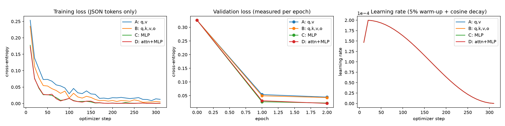

# Training: everything in one place

LoRA fine-tuning of `ibm-granite/granite-4.0-h-350m` on the TronOS command dataset. Four target-module experiments, A–D, were trained on Kaggle (NVIDIA T4, FP32), one experiment per GPU.

| What | Where |
|---|---|
| Training script | [`scripts/train_lora.py`](../scripts/train_lora.py) |
| Kaggle runner (installs, launches A–D, streams logs) | [`kaggle_job/kernel/run.py`](../kaggle_job/kernel/run.py) |
| LoRA configs (hyper-parameters + target modules) | [`configs/granite__v12__lora_{A_qv,B_attn,C_mlp,D_attn_mlp}.json`](../configs) |
| Training data | [`data/v1.2/train.jsonl`](../data/v1.2/train.jsonl) (2,510), [`val.jsonl`](../data/v1.2/val.jsonl) (354) |
| Trained adapters | [`runs/granite/<exp>/adapter/`](../runs/granite) (`adapter_config.json` + `adapter_model.safetensors`) |
| Loss / LR history + final metrics per run | [`runs/granite/<exp>/train_log.json`](../runs/granite) |
| Raw console logs from Kaggle | [`kaggle_job/logs/out_v4/`](../kaggle_job/logs/out_v4) (C, D; A/B cut at the 2 h limit) and [`kaggle_job/logs/out_v5/`](../kaggle_job/logs/out_v5) (A, B rerun) |
| Learning curves | [`results/plots/lora_training_curves.png`](../results/plots/lora_training_curves.png) |
| Results per experiment | [`results/eval/granite_v12_lora*_{val,test}/metrics.json`](../results/eval) |

## Hyper-parameters (same for A–D)

| Setting | Value |
|---|---|
| Rank r / alpha / dropout | 16 / 32 / 0.05 |
| Learning rate | 2e-4, cosine schedule, 5% warm-up, weight decay 0 |
| Epochs / steps | 2 / 314 |
| Batch | micro-batch 1 × gradient accumulation 16 = 16 |
| Max length | 640 tokens (longest sample 551) |
| Precision | FP32 |
| Loss | Cross-entropy on the assistant JSON tokens only (system prompt + command masked) |
| Seed | 42 |

## Experiments

| Exp | Target modules (regex) | Trainable params | Train time (T4) | Val loss (start → epoch 1 → epoch 2) | Test exact JSON |
|---|---|---:|---:|---|---:|
| A | `self_attn.(q_proj\|v_proj)` | 163,840 | 51 min | 0.326 → 0.054 → 0.0446 | 77.5% |
| B | `self_attn.(q\|k\|v\|o)_proj` | 327,680 | 52 min | 0.326 → 0.049 → 0.0429 | 81.4% |
| C | `shared_mlp.(input_linear\|output_linear)` | 3,932,160 | 61 min | 0.326 → 0.028 → 0.0229 | 85.5% |
| **D** | **attention + MLP** | **4,259,840** | 61 min | 0.326 → 0.031 → **0.0215** | **89.1%** |

D was selected on validation and is the deployed model. Base model FP32 test exact = 32.5%.



## Run it

```bash
python scripts/train_lora.py --config configs/granite__v12__lora_D_attn_mlp.json
```

Output goes to `runs/granite/D_attn_mlp/` (adapter + `train_log.json`). On Kaggle, upload the repo as a dataset and run `kaggle_job/kernel/run.py`.
